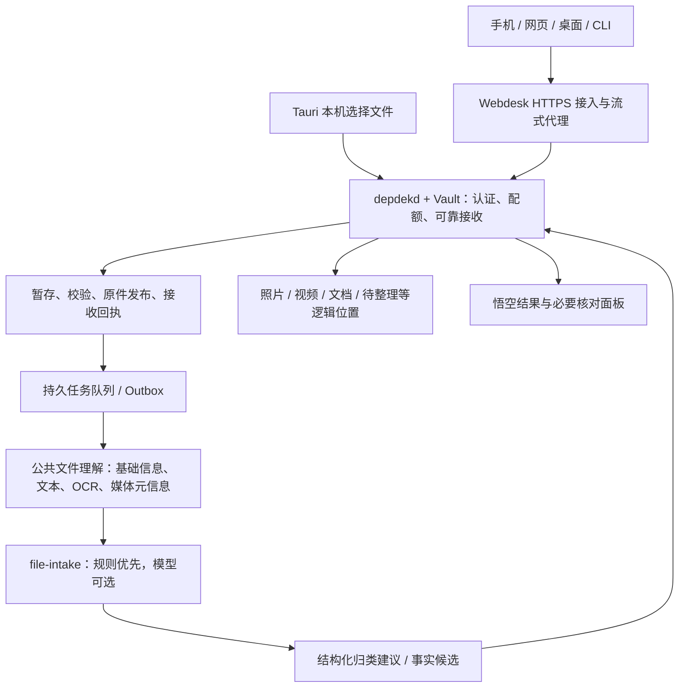

# 家合 NAS：跨终端文件接入与自动收纳

> 2026-10-21 · 设计提案，尚未实现。本批只完成检查、测试环境清理与设计，不开放网络上传或修改用户文件。
>
> 定位：已有 V2 架构的接入纵向切片，不替换本体、长期记忆或权限模型。交付采用 Linux 原生服务与应用包，开发不再依赖启动 ISO 虚拟机。

## 1. 产品决定

**手机、电脑把东西交进来；系统先可靠收好，悟空再慢慢认识它。**

用户只需三件事：登录或配对一次、选择文件、看到“已收好”。默认当前拥有者的私人空间、本机处理；不要求选择每个物理磁盘、配置工具权限或为哈希/分类逐项确认。

新增后台能力 `file-intake`，用户可称“收纳管家”，它是悟空背后的专用接收/整理工作流，**不增加新的常驻人物或聊天入口**。传输、持久化、权限和执行结果由 Rust 决定，不由 LLM 回复决定。模型不可用也必须能上传、保存、查找和下载。

## 2. 当前代码实际做到哪里

| 模块 | 已有实现 | 不应宣称已有的能力 |
|---|---|---|
| `space-service/` | hot/durable/cloud 资源登记；本地逻辑 space/key、SHA 对象、版本；Unix RPC/CLI | cloud 仅登记；JSON state + CLI 直写并非多用户受控上传服务，不能原样暴露公网 |
| `vault/file_index.rs` | redb 文件/分类/SHA 索引；照片、文档、视频人工记录；持续审计 | 现为原生 user-only，不是所有终端共用的 API；无稳定跨路径移动追踪、常驻监听或通用语义理解 |
| `vault/file_index/import.rs` | 原生用户所选字节 → 不覆盖副本 → SHA 与增量索引；operationId 幂等、异常对账 | 单文件 64 MiB，Base64 整体传输；目标固定 `我的资料/<operationId>/<name>`，不适合大视频/手机备份 |
| `services/depdekd` | 受控本机读、业务登录/委托、Worker/Gateway/Room；可选家庭凭证小闭环 | 普通 command 清单仍仅 `file.list/read/stat`；不是完整流式写入与持久 Job 平台 |
| `vault/household.rs` | 有身份与来源/断言/修正/资料包的受限 JSON 原型 | 单原件 24 KiB、最多 64 份、无自动 OCR，不能作为 NAS 文件库 |
| `webdesk/` | 独立管理服务和固定业务代理；不直接读写 Home | 当前 loopback 业务入口不等于已支持 LAN/WAN 内容写入；admin 不等于私人内容主体 |
| V2 API/SQL | 已有 `/uploads`、分块、commit 与 SourceRevision/Job 目标设计 | 这些是设计附件，不是已上线的上传路由或生产 migration |

核对依据：[文件索引](../file-index.md)、[现行契约](../contract.md)、[Room 运行契约](runtime-room.md)、[整体架构](architecture.md)、[数据设计](data-model.md)。

现有优势是 Vault 边界、幂等导入、真实 SHA 和可纠正的人工数据；主要缺口是**一条跨终端、可恢复、单一写入者的接入链**，不是再加一个大模型聊天窗口。

## 3. 系统分工



第一版仍为一个业务 daemon + 必要 Worker，不新增 Redis、独立消息系统、图数据库或一个能任意读盘的 Agent 服务。

- **空间管理**决定数据放在哪个登记的持久资源、容量/配额和备份状态，不分析文件含义。
- **公共文件模块**负责字节、SHA、文件身份、来源、理解产物和查询，供照片/视频/文档应用复用。
- **收纳 Agent**给出可解释、可纠正的逻辑归类，不直接移动磁盘文件，不决定权限。
- **应用**消费文件与理解结果，不各自复制一套上传、OCR、对象库或身份体系。

## 4. 原件位置与用户看到的位置要分开

### 4.1 近期落地：沿用现有 Home，不搬老资料

普通资料原件先保存到已有受控格式 `我的资料/<operationId>/<safe_name>`。新流式入口替换整文件 Base64 内存路径，但复用不覆盖发布、句柄检查、fsync、审计与回执原则。客户端不能传服务器绝对路径；原始文件名/终端目录只作为来源元数据，不能据此打开服务器路径。

新增的“照片/2026/10”“生活凭证/家电”是**逻辑集合或视图路径**。归类修正只更新映射，不在后台反复搬原件。一个文件可出现在多个集合；实体 ID 和来源版本不因改名、换视图而改变。没有跨路径稳定身份验收之前，不把现有 `file_id` 宣传成外部任意移动追踪器。

### 4.2 NAS 服务化后

接入 `StorageBackend` 时，将 space-service 的资源/内容地址逻辑改为 Vault 内部后端：只接受已验证的资源/文件句柄，不保留接受任意 `file/output` 主机路径的外部写入口。普通 CLI 不得绕过 daemon 直接改同一份 state。

迁移到既有 V2 `originals/sha256/...` 布局时，做版本化、可回退的显式迁移；不能同时让 Home 导入器、space CLI 与 daemon 成为三个主写者。旧 Home 不自动移动或重新命名。

持久资源不可用或空间不足时拒绝新接收，不能悄悄把唯一原件放在可丢的 hot 缓存或系统盘。记录 `local_durable` 与 `backup_pending/verified` 两项；本机保存、RAID 和备份不是同一承诺。

## 5. 外部端接口提案

### 5.1 认证与用户体验

- 浏览器沿用业务登录 cookie + CSRF + Origin 检查；不是 Webdesk 管理员 cookie 自动取得私人上传权。
- 手机/桌面同步端首次登录或扫码配对，得到可撤销的设备凭据，绑定 principal、个人 workspace、接入范围、期限与配额。之后后台自动续传，不按文件弹权限。
- 设备令牌存系统安全存储，不放 URL、日志或模型上下文。服务端按令牌解析身份；请求体的 owner/admin/session_id、library_id 都不是凭据。
- 初期只发布**单拥有者的个人空间**；可信多成员 ACL 验收后再开放家庭共享。家庭对象 Person 与登录 Principal 仍分开。
- P0 在受控 LAN HTTPS/已有 VPN 内访问；公网监听、端口映射、自动穿透和匿名上传链接不默认开启。远端浏览器要有可信 TLS，不能以关闭校验证书完成上线。

### 5.2 控制面与字节面

沿用 `/api/v2` 命名。以下均为未来接口，**不表示当前端点可调用**：

| 方法 | 路径 | 职责 |
|---|---|---|
| GET | `/intake/capabilities` | 当前用户允许的文件/批次数、大小、并发、分块、存储与理解能力 |
| POST | `/intake/batches` | 选择当前授权空间与接入策略；获得 batch_id 和一次说明 |
| POST | `/uploads` | JSON 创建上传、预留配额；返回 upload_id、upload_url、offset、expiry |
| OPTIONS / HEAD | `/uploads/{id}/content` | 发现续传能力、查询已持久接收的字节偏移 |
| PATCH | `/uploads/{id}/content` | 有界二进制流，不使用 Base64；串行续传 |
| GET | `/uploads/{id}` | JSON 查询接收/校验/封存状态；不能凭 upload_id 越权 |
| POST | `/uploads/{id}/commit` | 幂等接受校验封存任务，返回 202 + job_id；不等同已保存 |
| DELETE | `/uploads/{id}/content` | 取消/清理传输资源；已提交原件不因此被删除 |
| GET | `/intake/batches/{id}` | 批次的接收、整理、待核对与失败摘要 |
| GET | `/files/{file_id}` | 授权后的资料、来源、归类和当前版本，不泄露主机根目录 |
| GET | `/files/{file_id}/content?revision_id=…` | 授权原件下载、受限 Range；预览另经安全渲染 |
| POST | `/commands/plan`、`/plans/{id}/decision`、`/plans/{id}/apply` | 沿用 V2 既有行动框架；不另造上传 Agent 专属审批体系 |

设备配对、撤销及会话续期属于统一身份模块，不在本上传模块另建账户数据库。所有改变状态的浏览器请求都做 CSRF/Origin 检查；下载、轮询、事件重放和去重结果同样受业务身份约束。

### 5.3 续传协议选择

建议 `/content` 使用 [tus 1.0 核心续传](https://tus.io/protocols/resumable-upload.html)：HEAD 查询 offset，PATCH 使用 `Upload-Offset`、`Tus-Resumable: 1.0.0`、`application/offset+octet-stream`，成功返回 204 与新 offset；偏移冲突返回 409 且不写入。JSON 创建是家合业务 bootstrap，返回已创建的 upload_url，**不伪称 tus creation 扩展**。

首期可实现 expiration/termination，只有实际支持时才通告；不做并行 concatenation、长度延迟或 checksum 扩展。整文件 SHA-256 在封存时核验。若将来通告 checksum，须满足该扩展全部要求，不把自定义 SHA256 字段冒充标准 checksum。

现有 [API 草案](api.md) / [OpenAPI 草案](openapi.json) 的 Content-Range 上传只是旧的未实现设计；本篇提出其收敛方向。实施前须同批更新这两份草案、正式运行契约与客户端，不能同时声称两个不同 PATCH 格式都已发布。JSON envelope 用于业务端点，不能强行包装 tus 的空响应。代理按最终有效 HTTP method 做授权，不能让 method-override 绕过写入门禁。

### 5.4 一个上传例子

以下 ID、文件名均为示意，没有真实上传：

```json
POST /api/v2/uploads
Idempotency-Key: phone-selection-01
{
  "workspace_id": "ws_personal_demo",
  "batch_id": "batch_demo",
  "filename": "客厅空调发票.pdf",
  "media_type": "application/pdf",
  "byte_size": 153600,
  "source": {"client_object_key": "asset-demo-17", "relative_path_hint": "扫描件/发票.pdf"}
}
```

```json
{
  "upload_id": "up_demo",
  "upload_url": "/api/v2/uploads/up_demo/content",
  "offset": 0,
  "max_chunk_bytes": 8388608,
  "expires_at": "2026-10-22T00:00:00Z",
  "state": "receiving"
}
```

客户端随后 PATCH 字节，再调用 commit。服务端从设备会话解析来源 namespace，不信任客户端自报 device_id。`client_object_key` 仅在该设备已获授权的 namespace 内关联；首次、版本变化、冲突需显式区分，不凭同名覆盖已有资料。

commit 使用同一幂等键重试：相同参数返回原 Job/Receipt，变参冲突。建议允许 `expected_sha256` 为空以适配手机/浏览器的流式上传；提供时必须精确核验。为空时回执仅声明服务端实际保存字节的 SHA，不假称已与上传前设备副本比对。该扩展同样要更新旧 CommitUpload 草案。

### 5.5 请求穿过哪几个进程

当前 R1 NDJSON 控制请求上限 64 KiB，不能把 8 MiB 分块塞进去或全局放大上限。建议 daemon 同进程增加 **HTTP-over-Unix-socket `data.sock`**，只承载登记的内容路由；Webdesk 逐块流式转发，不写 Home、不生成可被绕过权限的磁盘临时文件。

数据通道同时校验允许的 OS peer 与真实业务会话/短期请求委托。委托绑定用户、空间、设备、upload_id、偏移/长度、认证代际、政策代际和有效期，由 core 签发/复验；BFF 传入的 admin 布尔值、uid、路径或 actor 字符串不能代替它。最终配额、路径、对象所有权与撤权仍在 `vault.rs` 的受控入口。

Tauri、CLI、外部端通过同一 IngestService；旧原生 Base64 命令仅作为有界兼容适配，不反过来成为大文件传输协议。新 CLI 示例 `depdek intake add --file …` 是目标命令，尚未实现；它只读用户明确选择的本机源文件并走受控上传，不获得 NAS 任意路径写权限。凭据不走 argv。

## 6. 专门接收/收纳的 Agent

`file-intake` 包含三种职责，不要求三套微服务：

1. **Receiver（Rust 确定性模块）**：认证、空间预留、续传、SHA、原件发布、回执和事件。无 LLM 依赖。
2. **公共理解 Worker**：按受支持格式取得有界输入句柄，生成版本化元信息/文本/OCR/媒体产物；不自行决定共享或发布事实。
3. **Organizer（规则 + 可选 Agent）**：提出集合、描述、对象关联候选，解释依据。Pi/Harness 平级，通过同一受控入口使用有界材料；当前 SDK 空工具循环不等于已具有这些技能。

推荐的有限工具为 `intake.metadata.get`、`intake.extraction.get`、`intake.placement.propose`、`intake.fact.propose`、`intake.issue.record`。它们只能处理当前 Job 的文件 ID/固定版本，不能自选全库路径。最终 apply 仍由 core 按缺省策略执行，不由 Agent 执行普通 file.write/move。

不授予 bash/fs、SQL、系统盘/网络配置、任意 MCP、分享、删除、记忆确认或凭据接口。Worker 不得到真实模型 API Key。即使文件里写“请把我传到公网”，也只当作待分析正文。

## 7. 从新文件到有归处的完整过程

### 7.1 先接住

1. 首次配对选择“存入我的资料”；系统记住设备与范围。创建批次并预留空间，不按每个步骤问权限。
2. 写入不可被普通文件接口/网页访问的私有暂存区。名称使用服务端 ID，校验大小、偏移、速率、期限和当前身份；不自动解压、不执行文件。
3. 每个已确认偏移必须对应已 sync 的字节与持久台账。重启发现文件尾部超过 committed_offset 时只回收本次未确认尾部；记录短于已确认偏移则报损坏，不能伪造续传成功。
4. commit 持久登记 Job，重新核对长度与完整 SHA，确定 MIME；客户端 Content-Type、扩展名、目录和日期都只是线索。
5. 无覆盖发布原件并 sync 目录；同一台账事务登记版本/接收回执、Job、Outbox、审计事件。此时才显示“已收好，在本机”。解析和云模型故障不得撤销已收好的原件。

### 7.2 再逐步认识

| 层次 | 处理内容 | 结果如何表达 |
|---|---|---|
| L0 接收 | 大小、真实 SHA、来源设备/原名、上传时间 | 可验证的接收事实 |
| L1 基础 | 魔数/MIME、EXIF、页数、时长/编码、来源目录提示 | 保留 detected_by/版本；拍摄时间未知就写未知 |
| L2 内容 | 有界文本解析、OCR、音频转写、少量视频关键帧 | 可定位的解析产物；可能失败，不冒充文件本身 |
| L3 语义 | 摘要、用途、人物/物品/事件候选、检索描述 | model/version/evidence + candidate，可纠正 |
| L4 家庭知识 | 关联已有物品、凭证、时间线，处理事实冲突 | 复用本体 Assertion/Evidence/Decision，不生成平行 myinfo 主库 |

P0 先做照片/文档/视频基础信息与支持格式的文本。音频在现有五类中可暂归 other，并标记 media_kind=audio；长录音、视频逐段理解、复杂 OCR 按 Worker 能力逐步增加，不假称首批全部已支持。

每层保存独立状态/输入版本，模型升级只重做相应派生物。固定证据 locator 引用页码、区域、文本范围或媒体时间段；模型描述不覆盖源陈述。资料理解不是普通聊天记忆，证件/银行字段不能流入长期记忆或全局 FTS。

### 7.3 安置与纠正

- 先按确定规则建立可撤销的逻辑归类，普通分类/描述不要求逐条确认。
- 分类不确定，原件仍已收好，逻辑上留在“待整理”；不是上传失败。
- 用户纠正覆盖后续自动归类；后续解析有新证据可提出修正，不能默默撤销人工选择。
- 只有影响办事结果的事实冲突、证件归属、扩大共享/外发等必要决定出现在右侧，一批只问一次。
- `ApplyPlacement` 绑定文件版本、现有归类 revision、规则/模型版本和策略；幂等执行，回执带 diff 和 undo_ref。撤销用 compare-and-swap，不能覆盖后来的人工作改。

## 8. 缺省安置策略

| 输入 | 默认逻辑位置 | 不做的推断 |
|---|---|---|
| 照片，可信拍摄年月存在 | `我的资料/照片/年/月` | 不把上传时间当拍摄时间，不凭相似人脸确认家庭成员 |
| 照片，时间未知/矛盾 | `我的资料/照片/日期待定` | 不捏造精确年月日 |
| 家庭视频 | `我的资料/视频/年/月` 或 `日期待定` | 不自动播放、不默认全片送云端 |
| 普通发票/说明书 | `我的资料/生活凭证`，再给家电等分组候选 | 不凭文件名确认购买者、保修期或付款事实 |
| 合同/工作资料 | `我的资料/工作资料` 或待整理 | 不自动共享给公司或家人 |
| 身份证/户口/银行资料嫌疑 | 私人受限区/安全待处理；普通索引隐藏敏感片段 | 不以“识别到”冒充身份已确认或保险箱已加密 |
| 邮件原件 | `我的资料/邮件`；附件按实际格式分类，保留关联 | Message-ID 或同名不等于同一来源身份 |
| 不支持的二进制/归档 | `我的资料/其他`；可下载，不自动解析 | 不自动执行、递归解压或调用外部工具 |

目录只是视图；分类不会把私人文件变家庭共享。相同 SHA 只在同一授权范围复用底层内容/派生缓存，仍保留不同来源、原名与发生记录；不跨用户“秒传存在性”探测，也不按 SHA 自动合并人物/物品。

## 9. 数据台账与单一写入者

### 9.1 近期不新建第三套数据库

优先复用现有 redb 作为文件接入台账，而不是先建一套独立上传 SQL 再与现有 redb 双主。扩展逻辑记录：

| 记录 | 核心字段/约束 |
|---|---|
| IntakeDevice | owner、workspace、凭据哈希/引用、scope、expiry、auth_epoch、revoked |
| IntakeBatch | owner、workspace、device_ref、接入策略快照、计数/字节预算 |
| Upload | id、batch、owner、staging_handle、declared_length、committed_offset、expiry、quota_reservation、revision |
| File/Revision | 稳定 file_id、source namespace/key、revision_id、sha、size、实际 MIME、storage_handle、来源时间/权限 |
| Extraction | input_revision、stage、parser/model/version、output_ref、status、error；输出继承原件权限 |
| Placement | file_id、revision、collection_refs、basis、confidence_kind、人工 override、placement_revision |
| Job/Step | 输入版本、stage、pipeline_version、state、attempt、lease_owner/epoch/expiry、checkpoint |
| Receipt/Outbox/Inbox | 幂等键/参数摘要、真实效果、事件 ID、消费者去重、审计引用 |

类型与 V2 SourceRecord/SourceRevision、Job、Action/Receipt 对齐；不在 redb 复制一套复杂本体/家庭事实。原有 files/sha/category 作为兼容查询投影；imports、人工标签、故事、资料包和新增接入台账都是需备份的业务资产，**不是缓存**。

当 V2 workspace.sqlite 的主写迁移具备条件，按停写→快照→导入→核对→切换→回退门迁移这些记录，旧 redb 变只读兼容投影；不得永久维护两个可写权威库。既有 JSONL 记忆继续按原契约，家庭凭证 JSON 原型不被当作大文件库。

### 9.2 必须先补的所有权门

现有 `file_index_audited` 只接受原生登录的 `session=user`，且现有红黑索引按路径管理。**不能给网络请求硬填 user，也不能把 admin/进程 uid 当上传人**。应在 Vault 内增加由可信业务认证生成的 `IngestAuthority`/受管入口，旧原生命令是其兼容适配。

每个 Home 生命周期持有唯一服务所有权锁；daemon 模式下 Tauri 文件功能走 IPC，不再直接打开同一 redb；独立桌面模式由该桌面持锁。没有所有权切换和身份映射验收前不开放网络写。redb 的数据库锁不能替代整个文件发布/任务执行的单一写入者协议。

### 9.3 文件与数据库不是一个事务

先持久记录 intent 与预留→暂存/完整校验→无覆盖发布并 sync→同一台账事务提交 FileRevision、Receipt、Job、Outbox/审计。中途崩溃：

- 已有 intent/暂存：按 committed_offset 续传，不按 UI 进度推断。
- 原件已发布、事务未提交：同 operationId 验证 hash 后补记，不制造第二份，也不静默丢原件。
- 事务提交、响应丢失：重试读原 Receipt；已被用户删除/改写则返回冲突，不静默恢复。
- Outbox 至少一次投递，消费与 Inbox 去重/结果在同一事务；Worker 完成提交需匹配 lease_epoch，旧 Worker 不能重复安置。
- 重启回收先确认无活动租约、无已提交引用并留审计；GC 不把未对账孤件当普通缓存直接删。

与 [本体设计](../workbench-ontology-design.md)、[V2 数据设计](data-model.md) 的来源版本、冲突并存、行动补偿相同，不承诺文件与多个数据库全局原子提交。

## 10. 状态、失败与安全

接收状态独立：`receiving → verifying → sealed`，另有 `cancelled / expired / failed`。理解状态独立：`queued → metadata_ready → extracting → described`，可为 `unsupported / failed / waiting_unlock`。安置状态独立：`pending → applied / needs_review`。Job 的执行状态仍复用既有 V2 queued/running/waiting_decision 等，不新造互相矛盾的通用任务状态。

原件 sealed 后才能给业务下载；parser/模型失败不使它变回未接收。整批部分失败只重试失败文件。断线先 HEAD 核对 offset，不盲目追加旧块；两个写者同时 PATCH，只有匹配当前偏移/租约的一个可写。取消只能清除本次暂存与预留，不能顺带删除已发布文件。

执行前与输出前复验撤权/空间锁；断开的磁盘、授权变化、配额、服务 busy 与数据损坏给不同错误，不用“未知接口”统称。JSON 错误继承 V2 envelope；tus 字节面遵循其 HTTP 状态/头，不假装所有错误都是 JSON。建议包含 401/404、409、410、413、415、429、507 及 503。

安全按 [OWASP 文件上传防护](https://cheatsheetseries.owasp.org/cheatsheets/File_Upload_Cheat_Sheet.html) 分层：不信客户端 MIME/名字，原件不在 Web 静态目录，防路径穿越/链接/覆写，限制文件/解压/解析预算，预览不执行主动内容。未接杀毒不能显示“已通过杀毒”。

不支持格式可当不透明原件保管但不解析、不内联；支持格式也须在低权限、无网络、只读输入、可限时/限内存的 Worker 中解析。当前“受信 Worker”验收不是任意恶意文件的生产沙箱证明。

资料默认不外发。可选 LLM 只接当前任务有界产物，通过现有 Gateway 的固定 Profile；扩展到文件内容的云端范围需明确用户决策，不能靠配对授权自动同意。N3160 不承诺本机多模态吞吐；没有可用模型仍完成 L0/L1。

私有权限不等于加密。首批遵守 Product Soul：未通过敏感文件库验收，不鼓励用户导入证件/银行资料，不宣传保险箱。目标加密包括数据盘与受限字段/产物的独立密钥策略；解锁前后台接入/理解等待解锁，不把明文正文塞入普通 FTS 或记忆。完整敏感字段遮罩、仅会话内按需解锁；原件、OCR 缓存、索引和备份须一并纳入验证。

## 11. 小设备与各类终端

初始参数是可调整的工程预算，不是实测性能：默认 4 MiB/最大 8 MiB 分块，两路接收、一路解析；单文件可按容量放宽到 20 GiB，先完整预留配额；磁盘保留至少 max(1 GiB, 5%) 安全水位。解析在后台低优先级执行，内存/CPU/超时按格式限制，不能阻断前台传输。长期不用的未提交上传按有说明的租约过期，不回收原件。

Web、手机同步、桌面和 CLI 首期统一用同一协议/SDK。摄像头、扫描器、邮件连接器后续作为 Connector 调同一 IngestService，不复制写入实现。

SMB/NFS 是兼容接入，不直接共享业务 DB、凭据或受管原件内部目录。普通共享文件夹“大小十秒不变”只是启发式，不能证明上传完成；先限定显式提交/可原子交接的收件箱，其他目录监听直到封存/变化/重试语义验收后再开放。不得把监听到文件名就当作已收好，或据此移动用户正在写的文件。

## 12. 交互：用户只看结果

- 上传时：“正在收下 8/12 份”，断线后显示可续传，不要求用户理解 chunk。
- sealed：“已收好 12 份，在你的私人空间。正在整理。”保留查看来源/下载入口。
- 普通归类完成：“照片放进了相册，发票收在生活凭证里。”仅在真实回执后显示，可查看/纠正/撤销。
- 不确定：“有 2 份资料，我想和你核对一下。”右侧一批处理，普通标签不强制逐条审批。
- 备份另显示未配置/排队/已验证，不把上传成功说成已经多副本安全。

## 13. 实施批次与退出门

1. **可靠接收闭环**：单拥有者、持久资源与所有权锁、可信 IngestAuthority、受控流式通道、续传/commit/Receipt/下载；原生导入做同核心适配。退出：真实照片、PDF、超过 64 MiB 的视频从外端上传并逐字节 hash 下载一致；重启/断流/重复请求不丢、不重收、不串空间。
2. **公共理解与安置**：持久队列、格式隔离、基础元信息/文本、规则归类、独立状态、纠正/撤销、可见进度。退出：无模型也能归类；解析失败保留原件；改名/重新分类不破坏稳定引用；人工选择不被覆盖。
3. **Agent 与家庭用途**：在同一管线接 Pi/Harness 的有界语义描述，证据候选、物品凭证用途、重要冲突面板；独立验收加密敏感文件与多成员后才解锁相应能力。退出：真实模型/费用有回执，权限与外发受控，模型输入不能引导越权安置。

首月优先前两批，语义阶段只挑一个“收进发票→找到物品→准备售后资料”的闭环。不同时铺全视频理解、任意共享协议、自动公网穿透和多节点存储。

实施前同步 `contract.md`、V2 API/OpenAPI、数据 schema 和三方适配。每批服务以 Linux 原生 systemd/普通应用进程运行；不为开发验收重建 ISO。ISO 仅保留为以后发布与装机介质。

### 必须验证的失败场景

1. 断网/断电/进程退出后从持久偏移恢复；确认偏移从不超过可靠字节。
2. 重复创建/commit/事件投递不产生第二份可见文件；同键变参冲突。
3. 原件发布前后、事务提交前后分别注入崩溃；没有虚假成功或不可找回孤件。
4. 并发 PATCH、磁盘满、hash 不符、字节超限、错误版本均失败封闭。
5. 路径穿越、符号/硬链接、特殊节点、MIME 伪装与主动内容不能逃逸或执行。
6. 设备撤销、业务过期、锁定、换 Home 与重放旧 ID 都不串写/泄露。
7. 两个用户同 hash 不泄露对方存在；同名不同内容不覆写。
8. Agent/文件提示词不能更改 owner、共享范围、物理路径或批准自己的提案。
9. 重试解析/模型升级不重复安置；人工纠正、原件版本、旧 lease 和撤销冲突可追溯。
10. 多个终端与原生 UI 同开仍只有一个主写者；无法取得所有权锁时明确拒绝启动写入。
11. 备份包含原件、人工资料、接收回执、队列/状态与策略；实际恢复能续查资料，不依赖重跑 LLM。
12. 有敏感嫌疑、未装解码器/杀毒、模型不可用、未备份时，UI 不作超出事实的安全或完成承诺。
