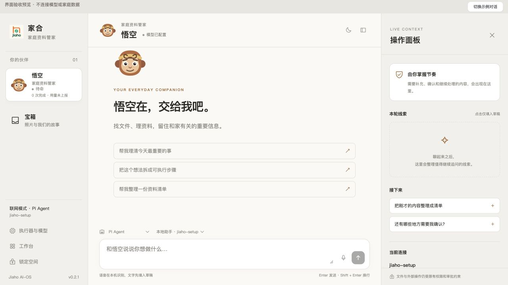

# 家合首屏 · 设计检查记录

日期：2026-10-18。范围：当前源码的悟空房间首屏；使用独立浏览器 fixture，不读取家庭数据，不是原生端完整流程审计。

## 1. 当前首屏：可用结构明确，默认信息偏多

截图由本轮重新构建的 `scripts/fixtures/AiOsRoomPreview.tsx` 捕获，不使用仍在运行的旧四角色预览。已打开保存文件检查，确认为单悟空、当前宝箱入口的首屏。

- 保留：真实家合 Logo、现有悟空头像、浅色界面、语音与文字入口；模型未配置/发送不可用的状态没有伪装成可用。
- 优化：首屏同时出现用量、执行器、模型、连接详情和默认右侧面板；这些内容挤压输入区，却不帮助用户完成第一件小事。
- 收敛：默认收起右侧，隐藏日常技术选择；保留查看处理范围与必要设置的路径。两个起点改为找资料、先聊聊。
- 无障碍风险：截图中次要说明偏小；后续以 16–18px 正文、明确焦点和 44px 操作区域改善。仅凭截图不能声称对比度、屏幕阅读器、键盘顺序或全部响应式断点通过。

## 2. 本轮输出与限制

交互 v0 另行独立预览，使用显式示例数据，未修改生产组件与安全契约。截图/交互检查不证明模型连通、业务身份隔离、真实文件预览、删除或备份恢复已完成。

后续实现任务、四项验收方式与退出条件统一维护在 [落地设计](../../jiaho-first-mile-design.md)，避免把视觉稿当成交付报告。
