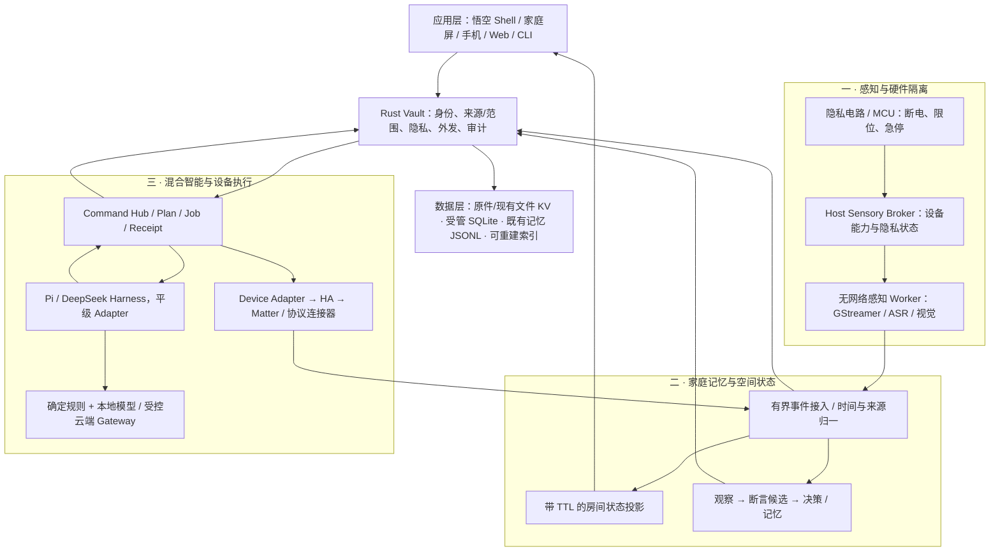
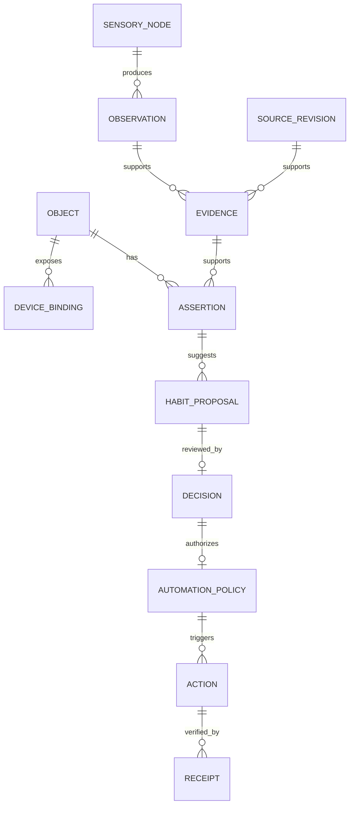

# 家合 Jiaho · 家庭感知与主动服务中枢

> 版本：设计 v0.1 / 2026-10-22  
> 对应产品：Jiaho AgentOS 家庭硬件扩展；当前软件 VERSION 为 0.2.1。  
> 交付：整体交互原型、软件架构、接口与数据设计、分批落地路线。  
> 状态：工程提案，未连接真实传感器、家电或模型，未进行目标硬件性能测量。

交互原型：[打开 HTML](design/jiaho-home-hub-v0/index.html)。支持直接打开本地文件；素材随目录提供。原型只使用虚构家庭数据和预设回复，所有状态只留在页面内存。

2026-10-22 交互续版：用户进一步指定以悟空作为家庭管家，借鉴 Meta Muse。新的 [连续对话原型 v1](design/jiaho-wukong-butler-v1/index.html) 与 [管家交互及接入设计](jiaho-wukong-butler-design.md) 将右栏改为按需展开、增加同一悟空的后台任务交接；本文的感知、存储和安全架构继续有效。下文 §2.1 保留 v0 的界面记录，不作为覆盖 v1 的布局要求；两份原型都未切换正式应用。

## 1. 产品定义与设计依据

**家合是家中的一个可信伙伴：东西有归处，事情有着落，你可以慢慢说。**

感知帮助它了解当前环境，记忆帮助它延续正确的认识，受控行动帮助它把事情办妥。用户首先见到悟空和结果，系统内部的模型、设备协议、索引和容器收在设置与诊断之后。

本文扩展现有设计，不另建一套简化本体：

| 依据 | 本文关系 |
|---|---|
| [Product Soul](jiaho-product-soul.md) | 继续约束温度、分寸、缺省隐私、单一悟空和必要确认 |
| [工作台本体](workbench-ontology-design.md) | Object / Assertion / Evidence / Relation / Action 继续有效；冲突不得覆盖 |
| [V2 架构](agentos-v2/architecture.md)、[数据设计](agentos-v2/data-model.md) | 复用 Vault、Command Hub、Job、Context、模型 Gateway、单一主写与迁移机制 |
| [现行契约](contract.md) | 已运行的 Rust / sidecar / React 接口唯一标准；本文新命令均为候选，尚未登记为运行能力 |
| [NAS 接入设计](agentos-v2/nas-file-ingestion-design.md) | 外部端接入、续传、来源版本与收纳继续沿原路线，不与传感器原始流混用 |
| [设计系统](DESIGN.md) | 暖白、墨绿、真实 Logo、现有悟空；本文只增加独立原型作用域 |

### 1.1 当前实现与新增设计的分界

| 模块 | 仓库当前依据 | 本次新增目标 |
|---|---|---|
| 单悟空 Shell / 语音草稿 / 三栏 | `src/lib/aiOsRoom.ts`、`DepDekAiOsShell.tsx`、`useRoomVoice.ts` | 房间状态与主动建议的上下文面板；保留文字与按键操作 |
| 首启、账户与重新登录弹窗 | `AiOsEntry.tsx`、`vault/welcome.rs`、`api.ts` | 设备配对与一次性照看范围选择；已有登录失效恢复模式继续使用 |
| Home 文件索引 | `vault/file_index.rs` 及 `file_index/`，私有 redb | 以资源/来源引用衔接家庭对象；保留原始路径、SHA 和分类能力 |
| 照片 / 视频 / 文档 | `TreasurePanel`、`VideoPanel`、`NativeDocumentsPanel` | 同一内容理解产物服务找回、挑选、故事/事务；不重复开发内容分析 |
| AI Content Agent | `AiContentAgent.tsx`、`contentEvidence.ts`、`sidecar/src/contentAgent.ts` | 扩展可复用的描述/标签候选，不将持续视觉直接接到云端内容分析入口 |
| 共享长期记忆 | `mydata/memory/events.jsonl` 及 propose/confirm/reject/tombstone | 设备习惯候选通过同一治理流程，兼容期保留 JSONL 单一事实源 |
| 凭据 | 桌面 Provider 加密引用、独立 R1 Secret Store、兼容 env | 统一迁移仍需单独完成；加密 Provider Key 不等于全部家庭数据库已加密 |
| Pi / Harness / R1 | 已有执行器、受控 Worker 切片，运行范围见 `runtime-r1-*.md` | 使用相同受控工具/回执；不能把原生界面自动视为已全面切换 R1 |
| 感知、房间状态、HA / Matter、云台 | 尚未形成本文所述闭环 | 全部属于新增设计和硬件适配工作 |

较早 V2 文档保留四角色历史描述，本扩展的用户主界面以当前代码与 Product Soul 的**单一悟空**为准。识别、记忆和设备执行是背后的技能/Worker，不增加三个陪聊角色。

### 1.2 对原设想的工程收敛

1. “绝对隐私”改为可检查的具体边界：硬件关断、原始流不持久化、范围授权、外发可见、删除阻断召回。不能承诺抵御已经完全控制主板/内核的攻击者。
2. 先做 Debian 衍生 appliance OS，沿用仓库 `os/`；Ubuntu 可作开发宿主。AOSP 为后续屏幕/伴随端或独立 BSP 适配，不与 Linux Docker 方案并行首发。
3. 200ms 转向与 500ms 响应拆成可测分段目标；不保证完整 LLM 回复、ASR、视觉问答都在 500ms 内完成。
4. 雷达表达“有人/无人/未知”；语音转文字、匿名说话人分离、实名声纹识别分别设计。检测到药盒打开不能认定某人已经服药。
5. 一个月内优先完成“同一房间 + 一组灯 + 找资料 + 可核对习惯”的可信闭环。全屋人脸/声纹、健康监护和复杂联动后置。

## 2. 整体 UI 与交互

### 2.1 主界面

```text
┌ 家合 ─────────── 当前页面 ───────── 镜头物理状态 / 处理方式 / 面板 ┐
│ 悟空        │                                            │ 家里此刻 │
│ 我的家      │          悟空在。家里的事，慢慢说。          │ 房间示意 │
│ 家的记忆    │                                            │          │
│ 我的资料    │          对话、简短结果、实际处理摘要        │ 当前线索 │
│             │                                            │ 或设备   │
│             │                                            │ 或核对   │
│ 安心与设置  │ ┌ 文字 / 语音草稿                 发送 ┐   │ 或回执   │
│ 私人空间    │ └─────────────────────────────────────┘   │          │
└─────────────┴────────────────────────────────────────────┴──────────┘
```

默认入口为悟空，不展示监控视频墙或技术仪表盘。顶部物理镜头状态常驻；模型处理方式可展开。左侧只有四个主要目的地，设置和私人空间置底。右侧一次解释一件事，可收起；手机改抽屉，主导航移到底部。家庭屏提供大字陪伴与夜间安静变体。

| 入口 | 首屏内容 | 右侧面板 | 主要动作 |
|---|---|---|---|
| 悟空 | 一个欢迎语、对话、三个可选起点 | 当前任务的来源/设备/计划/回执 | 说一句或发一条文字 |
| 我的家 | 房间示意，明确有人/未知、灯光与新鲜度 | 选中房间、设备状态、可用控制 | 一次明确调光 |
| 家的记忆 | 已确认偏好、少量值得核对的建议 | 原话/设备依据、适用范围、忘记/撤回 | 必要时确认一个习惯 |
| 我的资料 | 文件、相册、视频的统一入口 | 原件位置、描述候选、AI 标注与修正 | 找到或加入一份资料 |
| 安心与设置 | 物理镜头、说话方式、模型处理与数据管理 | 按需显示当前影响 | 调整一个具体偏好 |

### 2.2 简单而可靠的缺省值

| 选择 | 缺省 |
|---|---|
| 采集声音 | 按住说话；端侧唤醒词需首次明确选择，提供硬件麦克风静音 |
| 摄像头 | 首启关闭；打开遮光罩只是硬件允许，仍需完成一次本机视觉设置 |
| 声纹、人脸与实名轨迹 | 关闭；不因开启摄像头或关遮光罩而自动登记/启用 |
| 雷达 | 在接入时用一句话说明房间覆盖与存在状态；无登记不采集 |
| 设备控制 | 完成配对后，当前范围内低风险明确指令直接执行并核对；保留撤销 |
| 记忆 | 明确“请记住”的低敏偏好直接保存并可忘记；推测为候选 |
| 主动习惯发现 | 连接低风险设备时一次说明；默认只给设备层建议，不推断具体成员作息 |
| 云端 | 首启选择并说明一般聊天范围；家庭感知原始流不加入普通云端 Context |
| 家庭文件外发 | 按具体任务和文件版本说明范围，后续分块/工具调用不重复确认 |
| 分享 | 先私人；成员共享、扩大接收人需明确选择 |
| 主动服务打扰 | 夜间静默，按重要性合并；相同证据的拒绝不反复出现 |

不给家庭用户展示 Grant、UID、ACL、租约和工具名单。系统负责执行缺省政策；不能靠隐藏服务端权限检查实现“少打扰”。

### 2.3 四条关键流程

**找眼镜：**询问 → 检索获准的物品观察 → 显示“最后看到的位置 + 时间 + 不确定性”。原始帧若只留三秒，则不提供历史现场截图；镜头关闭期间不更新视觉线索。不能把物体类别自动当作特定家庭成员的私人物品。

**调灯：**明确指令 → 确定性语义映射 → 当前能力/范围核验 → 一次设备命令 → 回读 → 回执。API 接收成功但状态未到达时显示“结果待核实”，不能说“已经调好”。撤销会检查当前设备版本，避免覆盖家人刚做的新调整。

**睡前柔光：**三次低风险设备记录 → 习惯候选 → 用户看具体时间、亮度、范围 → 一次启用 → 持久策略。之后按已授权规则运行，不每天再次确认；设备范围扩大、条件实质变化才重新核对。相同三条记录不足以证明“某位家人每晚怎样”。

**准备维修资料：**问洗衣机凭证 → 统一文件索引与内容理解 → 原件/购买日的候选与来源 → 资料包草稿 → 必要时核对事实。对外发送是另一个有接收人和内容范围的行动。

### 2.4 界面状态与会话

每个视图有 loading / empty / unavailable / stale / permission / conflict / partial / confirmed 状态。绿色必须对应真实设备回读/已验证连接，不能把动画完成当成服务成功。

登录过期沿用全局弹窗，保留页面与草稿；成功后可刷新只读状态，失败的副作用不能自动重放。实体不可见时不泄露标题、计数或存在性。锁屏与公共家庭屏默认不展示私人对话、实名位置和敏感通知。

本稿的相机开关只存在于标明“演示设置”的 Tweaks。正式 UI 不提供能够越过物理遮光罩的“打开摄像头”按钮。

## 3. 三个功能层与现有三层中间件

感知、家庭记忆、混合执行是功能分工；数据/系统/应用仍是现有中间件的职责切面。进程按照权限和故障边界拆分，不把实时闭环都塞进三个大容器。



图中的 UI 输出仍经 Vault 可见性过滤，不是状态树绕过权限直连浏览器。原始视频/音频与结构化观察是两条不同的数据管道：前者不进长期库，后者按目的、范围和保留期接入。

## 4. OS、进程与容器部署

### 4.1 首发 OS 选择

沿仓库 Debian 镜像做硬件白名单发行物，保留 systemd、内核安全更新、必要 NAS 服务、网络管理、恢复入口。产品会话开机进入 Jiaho Shell；CLI 保留用于安装/维护和同一业务命令。首期不新增 ISO 虚拟机任务，本次只交付设计与原型。

AOSP 需要独立验证摄像头/音频 HAL、SELinux、NPU 驱动、前台服务与系统更新。常规 AOSP 产品不默认具有本方案所需的 Linux Docker/主机网络能力；优先作为屏幕端调用同一后端 API。未来 OEM 如果把它选为主机，须另做系统与协议支持矩阵。

### 4.2 最小部署单元

| 单元 | 部署/身份 | 允许访问 | 不授予 |
|---|---|---|---|
| Privacy MCU / 云台固件 | 独立硬件 | 遮罩回路、供电检测、麦克风静音、角度/电流/限位 | 家庭资料、模型、通用网络 |
| `jiaho-sensory-broker` | 原生 systemd，小型受限服务 | 固定 GPIO/串口设备、板级 HAL、受控共享缓冲 | 任意 shell、家庭目录、Provider Key |
| sensory Worker | 独立 uid；可用容器 | Broker 签发的流句柄、指定 NPU/音频设备、短期内存 | 公网、家庭 DB、摄像头任意重开、原始流导出 |
| `depdekd` | 当前 Rust 核心逐步迁入；非 root | 经 Vault 的业务数据、策略与事务 | Docker socket、自由 `/dev` 管理 |
| Agent Worker | Pi / Harness 隔离进程 | 当前 Run 的受控工具、最小 Context | 原件挂载、SQL、真实凭据、FS/bash、自由 HTTP |
| 本地推理服务 | 独立容器，可按硬件装载 | 模型只读目录、指定加速设备、Gateway 私网入口 | 家庭根目录、HA Token、互联网 |
| Home Assistant | 独立 IoT 容器与配置卷 | 选定 LAN 接口、必要设备与协议凭据 | Vault/文件索引/共享记忆、Docker socket |
| Matter Server | 独立 IoT 容器/实例 | Fabric 独立存储、所需 IPv6/mDNS、配对期 BLE | 家庭资料、Agent 内部接口 |
| Tauri / 家庭屏 / Webdesk | UI 与 BFF | 业务会话、受控 API；Webdesk 自有数据目录 | 原件/DB 的直接挂载或打开 |

Host Broker 的设备访问是额外 OS 边界；所有业务数据访问的最终授权继续落在 `vault.rs`。由 Vault 签发窄范围操作票据，Broker 只验证固定操作/票据/可信 peer，不接受 JSON 中自报角色。跨 UID IPC 校验真实 peer 身份。

### 4.3 容器与网络原则

默认 rootfs 只读、独立 uid、capabilities drop、no-new-privileges、资源预算、只挂载需要的路径；Agent 没有 Docker/Podman 管理 socket。摄像头/NPU 的驱动权限按板卡分别验证。

HA 的官方 Container 示例使用主机网络、D-Bus 和宽权限配置，不能直接作为家合“强隔离”的证明。产品需要按所支持集成缩减权限；如果特定 BSP/无线栈必须要求过大的主机权限，就放到独立 IoT 节点，或明确列入不支持清单。[Home Assistant Linux 安装](https://www.home-assistant.io/installation/linux)

| 流量 | 目标策略 |
|---|---|
| sensory / ASR | 无公网/DNS；只与 Broker/core 固定 IPC 交互 |
| Agent Worker | 只走受控工具 IPC 与模型 Gateway；无直连公网/LAN 家电 |
| Gateway | 登记的 Provider、协议、模型及证书策略；禁任意 URL/重定向旁路 |
| HA / Matter | 必要 LAN、IPv6/mDNS；配对/更新需要的外网单独受控 |
| Shell / Webdesk | 认证业务 API，远程 HTTPS / Origin / CSRF；不公开内网 Matter WebSocket |

“本机模型模式”与“设备断网”分别表达。本机模式允许已配置 LAN 家电控制；依赖云的设备集成标为受限。没有云端许可/可用模型时不自动替用户上传内容。

## 5. Sensory Sandbox

### 5.1 物理隐私链

建议用遮罩联动的硬件联锁/负载开关决定摄像头允许供电，Hall 信号和供电回读供 MCU 检查。仅让 Linux 收到 Hall 后再写 GPIO，不足以兑现“软件无法越过物理关闭”。电路的掉电默认态、MIPI 多路电源、I/O 反灌、电源残留与指示灯由硬件工程实测。

```text
允许视觉 = 遮罩确认为打开
        ∧ 硬件联锁允许
        ∧ 摄像头电源回读正常
        ∧ 该空间已完成视觉设置
        ∧ 当前采集租约有效
```

遮罩合上/信号失联/电源反馈异常时：硬件先切断 → 隐私代际 `privacy_epoch` 增加 → 停止并释放采集 → 所有旧代际帧/推理产物作废 → 清理环形缓存 → 标记视觉状态不可用/最后看到 → UI 回报。处理中的视觉结果不得在关断后补写知识；Broker/Core 都校验代际。软件只可申请“允许条件下打开”，不能绕过硬件联锁。

麦克风具有独立硬件静音和状态回读。关镜头不意味着关麦，也不能把关镜头当作开启声纹的授权。传感器离线与物理断电分别显示，不用同一个绿色隐私标识掩盖未知状态。

### 5.2 原始流只在受控内存短暂存在

- 视觉采集/缩放/抽帧/模型队列的**全部在途副本**都要计入总内存与最长年龄，目标至多 3 秒；背压丢弃旧帧，不追赶历史。
- 队列按时间、帧数和字节同时设上限，appsink 与解码器也设有界缓冲。GStreamer queue 支持这些限制与丢弃旧缓冲，但应用保留的样本引用仍由程序负责释放。[GStreamer queue](https://gstreamer.freedesktop.org/documentation/coreelements/queue.html)
- 不使用 filesink、录像、自动 dump、带原图的诊断日志；原始流不进入 HA recorder、审计、崩溃报告、截图或备份。
- 原始缓冲不写 swap/休眠镜像；限制并验证 mlock、禁止 core dump、设置不转储内存标志。`tmpfs` 本身不能作为“绝不落盘”的充分证明。
- UI 只收结构化结果；不能通过 debug 模式临时暴露持续视频。用户主动保存的家庭照片属于独立文件接入流程，有明确来源与持久化意图。

示例预算：640×360 RGB、5FPS、3 秒的**一个**完整帧窗口约 10 MiB；不能把这个数当成全管道上限，原始高帧率、解码器、DMA/NPU 拷贝都需另算。5FPS 是目标配置，不是全部 SoC 已可运行的事实。

### 5.3 感知模型的职责

| 能力 | 设计输入/输出 | 不能推导出的结论 |
|---|---|---|
| 物体检测 | 物体框、类别、版本与校准置信信息 | 检测到眼镜不代表就是某人的眼镜 |
| 图文特征 | 语义检索/分类候选，输出可追溯描述 | 图文相似度不等于确认事实或人物身份 |
| VAD + ASR | 激活窗口内的语音 → 草稿文本 | 文字本身不能证明说话人的登录身份 |
| 声源定位 | 方向、置信与时间，服务屏幕朝向 | DOA 不等于声纹或具体人物 |
| 匿名说话人分离 | 同一会话的 speaker-A/B | 不是实名成员识别 |
| 登记的声纹 / 人脸 | 独立可删除的本机生物特征模板；候选匹配 | 不能代替登录解锁、高风险操作确认 |
| 毫米波 | 覆盖房间的存在/移动/未知 | 不自动推断“妈妈在客厅”、服药或健康状况 |

SenseVoice 的 ASR 与说话人分离需要区分；官方说明分离使用独立 CAM++ 等模型，匿名标签不是个人身份。[SenseVoice 官方说明](https://github.com/QwenAudio/SenseVoice)

YOLO11、MobileCLIP、SenseVoice / Whisper、Qwen / MiniCPM 均是**候选实现**。建立版本、权重摘要、输入尺寸、量化/算子兼容与许可清单后才进入发行镜像；Ultralytics 的开源/商业许可需要产品单独核对。[Ultralytics 许可](https://www.ultralytics.com/license) [MobileCLIP 官方项目](https://github.com/apple-aiml-research/ml-mobileclip)

### 5.4 云台的实时闭环

XMOS/麦阵输出方向 → 时间/置信/唤醒状态检查 → 限速/死区/滞回 → MCU 角度目标 → FOC/位置闭环。实际电机控制周期留在 MCU，LLM 不处于控制回路中。

云台具备最大速度/加速度、电流/堵转检测、机械限位、线缆边界、手扶暂停、急停和看门狗。多人交谈、电视声、回声或方向置信低时保持当前方向，避免左右追逐；镜头关断不影响麦克风既有设置，但可独立暂停朝向。

“200ms”先定义为可信方向事件到开始安全转向的 p95 预算；转到位耗时随角度、机构、载重单独测。未经角度场景与干扰测试，不承诺 200ms 内完成所有转向。

## 6. Family Memory Engine

### 6.1 实时状态是投影，不是永久全屋真相

内存树由事件构建，每个叶节点带来源、采集时间、接收时间、有效期限、质量/未知原因、序号和隐私范围。数字孪生只覆盖已经登记的房间和传感器；不把一个房间的摄像头描述成全屋感知。

```json
{
  "workspace_id": "ws-demo",
  "revision": 41,
  "rooms": [{
    "object_id": "room-living",
    "presence": {
      "value": "present", "identity": null,
      "observation_id": "obs-demo-51", "source_id": "radar-living",
      "observed_at": "2026-10-22T11:42:00Z",
      "valid_until": "2026-10-22T11:42:30Z", "quality": "observed"
    },
    "light": {"device_id": "light-living", "brightness_pct": 42, "quality": "verified"},
    "vision": {"available": false, "reason": "physical_shutter", "privacy_epoch": 8}
  }]
}
```

30 秒只是存在状态初始 TTL 示例，最终按传感器心跳/覆盖验证。过期就变 unknown，不延续为“仍有人”或“确定无人”。重启后从设备快照/订阅重建；磁盘旧状态只能标为 last_known，不能短暂伪装实时。

### 6.2 三类不同的“知道”

| 记录 | 例子 | 默认用途 |
|---|---|---|
| Observation 观察 | 灯亮度变为 20%；检测到药盒被打开 | 暂态环境、证据与低风险候选；不自动写成人的事实 |
| Assertion 断言候选 | 可能希望 23 点调暗书房灯 | 带证据的待核对建议；可冲突、可过期 |
| Confirmed preference / Policy | 用户明确选择书房灯工作日 23 点调到 20% | 可召回偏好或精确自动化，保留确认与撤回 |

健康相关观察默认不进入常规自动记忆。药盒打开、姿势、药瓶靠近嘴部均不足以证明服用、剂量或遵医嘱；首期不提供已服药判定、医疗异常监护和自动用药决策。

### 6.3 分层保留策略（产品初始值，待内测校准）

| 数据 | 初始保留 | 处理策略 |
|---|---|---|
| 相机/音频原始流 | 活跃窗口，视觉全部副本至多 3 秒 | 不持久、不备份、不发云 |
| 房间存在/匿名轨迹 | 内存 TTL；不默认记录可检索人员轨迹 | 仅当前上下文，失效即 unknown |
| 本次语音文字 | 当前会话；保存聊天遵循聊天设置 | 唤醒前不生成家庭对话历史 |
| 获准的低风险灯光事件 | 7 天，按变化合并 | 不带实名成员；用于设备规律建议 |
| 长期物品位置线索 | 该用户主动开启寻物后，初始 24 小时 | 只保留最少结构化文本/房间/时间，无现场图；过期不说成当前位置 |
| 未采纳习惯候选 | 最长 7 天或证据失效 | 到期清理，不因午夜重跑永久续命 |
| 明确确认的偏好/策略 | 直到撤回、有效期结束或被修正 | 保留最少确认来源和必要结构化依据，支持查看/忘记 |
| 生物特征 | 首期关闭；后续按显式登记策略 | 独立受保护模板库，不进入一般全文/向量索引 |

接受一项习惯时，必要的结构化依据可按同一目的封存为最小 EvidenceSnapshot；不是延长原始视音频。用户删掉来源或撤回共享后，同步阻断所有派生召回，不能让快照扩散权限。已有备份的历史版本及物理存储擦除期限应另外解释。

### 6.4 夜间记忆整理

```text
当地维护窗口（默认 03:00，界面无通知）
  → 数据盘已解锁 / 资源允许 / 单任务租约
  → 截止游标固定 + 仅目的允许的事件
  → 规则聚合（去抖、同设备归组、覆盖率）
  → 本地模型补充候选解释
  → 来源/权限/敏感性/既有拒绝复核
  → 创建或更新 Proposal，不自动改变已确认事实
  → 次日有意义时显示一条简短核对
```

用 `(workspace, window_start, window_end, pipeline_version, input_digest)` 幂等，任务有检查点、输入水位与完成回执。错过 03:00 在下一个低负载窗口补做一次，不能重启风暴；活跃对话、摄像头实时任务、备份与温控优先。没有本地模型时保留确定性聚合，不改成云端蒸馏。

候选输出保留 `evidence_refs / competing_explanations / coverage / valid_until / model_version`。三晚灯光事件可能是临时安排，不写“主人已形成习惯”。同一事件集的拒绝保存 suppress 指纹；来源新增、用户明确重新开启后再按政策产生新建议。

### 6.5 遗忘与检索

遗忘事务先写 tombstone/撤权代际与 suppression，再返回成功；检索、Context、缓存与自动化读取同步检查。向量索引是派生物，查询先限制授权空间/允许 ID，并在输出前复核。找不到支持前置过滤的向量后端就回退授权集合 FTS，不能先全库召回再泄露片段。

索引删除、FTS 清理、缓存清理、向量重建在后台有清单与进度。隐藏一张卡片不等于删除；删除后同一证据不能在次日晚间重新长出相同记忆。已发送给外部服务的数据无法靠本机 tombstone 追回。

## 7. 数据设计与加密

### 7.1 初期存储选择

采用现有原件/文件 redb + 每空间受管 SQLite + 既有治理记忆 JSONL。只新增必要逻辑表，不立刻引入独立图数据库、Chroma 服务或新分布式事件总线。空间树在内存；重要业务变化通过 SQLite outbox 持久化。

全文先用 SQLite FTS5，中文切词在源文本的派生索引阶段明确版本；选择经目标语料验证的分词实现，保留文件名/路径和精确词回退。向量接口可选内嵌 LanceDB，但 ARM64、内存、加密盘挂载与权限过滤未通过前不成为首发依赖；Chroma 只作为后续替换实现评估。

每空间一条主写队列，短事务，禁止通过 SMB/NFS 共享活跃 DB。SQLite WAL 的多库原子性、单写与检查点约束沿用既有数据设计。[SQLite WAL](https://sqlite.org/wal.html)

敏感空间可选 SQLCipher 加密主库，配合已解锁加密数据盘保护原件、FTS、向量与 HA 配置。SQLCipher 的临时文件需专门配置在内存，不能只加密主 DB 就宣称没有明文副本。[SQLCipher 设计](https://www.zetetic.net/sqlcipher/design/)

### 7.2 数据布局（目标，不是当前已建目录）

```text
/run/jiaho/                       IPC / 短期元数据；原始缓冲另由受限内存分配
/var/lib/depdek/control/           设备注册、主机配置、凭据引用；无普通内容 getter
/srv/depdek/workspaces/<id>/
  workspace.sqlite               对象、观察、习惯、Job/Action、outbox
  originals/                     受管原件与固定来源版本
  indexes/                       FTS / 可选向量 / manifest（派生）
  memory/                        兼容期 JSONL 权威事件；不双主
  audit/                         受控轮转，不存原始内容或完整模型请求
/srv/depdek/iot/ha/               独立 HA 配置；与家庭原件/记忆隔离
/srv/depdek/iot/matter/           独立 Fabric 与配对凭据
/srv/depdek/backups/              加密备份、schema/版本/密钥恢复说明
```

### 7.3 核心实体

全部工作空间实体带 `workspace_id`，关联使用复合外键；成员身份由服务确定，不由请求体声明。Room / Asset / Person 复用已有 Object，来源复用 SourceRecord/SourceRevision。

| 表/实体 | 主要字段 / 索引 | 权威性与约束 |
|---|---|---|
| `sensory_node` | id、registered_room_id、capability_manifest、firmware_digest、last_boot_id | 已登记硬件；不能从一段事件里自报所属房间或用户 |
| `privacy_state` | node_id、cover_state、power_feedback、mic_mute、epoch、measured_at | 来自受信 Broker/MCU；保存必要状态迁移，不保存采集内容 |
| `home_device_binding` | connection_id、external_entity_id、object_id、room_id、capability_version | UNIQUE(ws,connection,external_entity)；协议 ID 与内部 Object 分离 |
| `observation` | id、source_id、boot_id、seq、event/receive time、kind、typed_value、privacy_epoch、expires_at、security_labels | UNIQUE(ws,source,boot,seq) 去重；索引 `(ws,room,kind,event_time)` / `(ws,expires_at)` |
| `evidence` | 结构化 observation 或固定文件来源、producer_version、locator、retention | 复用本体证据；实时原图无持久 URI，不能伪造可点击截图 |
| `assertion` | object_id、predicate、value、status、evidence_id、validity、revision | 可冲突；不把模型置信度当用户确认 |
| `habit_proposal` | id、pattern_key、input_digest、evidence_refs、plan_id、status、expires_at | UNIQUE(ws,pattern_key,input_digest)；接受/拒绝/失效有版本 |
| `automation_policy` | id、trigger、conditions、typed_actions、scope、source_decision、revision、enabled | 受控规则，不含 YAML/JS/shell；运行时重新核验授权和设备能力 |
| `pattern_run` | input_watermark、pipeline_version、status、checkpoint、lease/fence | 幂等夜间整理，单实例租约，旧 Worker 不得提交 |
| `job / action / action_attempt / receipt` | 幂等键、参数摘要、输入/策略版本、尝试、外部 context、回读证据 | 沿用 V2 状态机；收到网络 ACK 不等于物理效果成功 |
| `consumer_inbox / event_outbox` | producer_id + event_id、committed revision、payload type | 至少一次投递；业务写入与 outbox 同事务 |
| `memory_projection` | source_event_id、status、scope、sensitivity、source_refs、source_hash | 既有 JSONL 的可重建投影，禁止反向直接覆写主写 |
| `suppression / deletion_barrier` | target_id 或 HMAC 指纹、policy_epoch、scope、reason | 同步阻断召回/重新生成，保留期独立说明 |

高频存在/方向样本不逐帧 INSERT，只在内存维护和变化点归一。灯光事件按实际变化去抖，避免 eMMC 写放大；审计使用有界队列、轮转与保留政策，隐私关闭事件优先落可靠记录。审计不可用时敏感操作拒绝。

### 7.4 关系与主写



共用一个受管 SQLite 事务时，写入断言、Proposal 与 outbox 可原子提交。跨既有 JSONL 与 SQLite 的记忆写入没有天然原子性：先经既有受控命令写 JSONL，按唯一事件 ID 投影；需要新增幂等写契约时先更新正式接口，不能用“双写成功”掩盖中间失败。主写切换必须冻结旧入口、导出校验、单次迁移、保留回滚副本。

### 7.5 加密、索引与解锁

密钥由 Secret broker/平台安全设施保护；UI 与 Agent 只见引用。声纹/人脸模板独立保存，不进入普通 embedding 索引。字段若单独加密，不再假定能全文检索；只对允许索引的派生文本在已解锁加密卷内检索，明文索引等同于明文泄露面。

无 TPM 设备使用用户主密码与离线恢复密钥；不是在同一磁盘明文放一把“自动解锁钥匙”。数据盘锁定时，私人检索、记忆与模型 Context 任务进入 waiting_unlock；必要网络/登录与已授权低风险设备基础服务可独立运行，不读取私人内容。无人值守自动解锁是用户可见的设备策略，不伪装成无代价默认项。

备份覆盖人工确认、策略、必要来源、原件、Secret 引用及恢复材料。向量可重建；数据库经一致性备份生成，不复制活跃 DB/WAL 三件套当有效快照。删除屏障在恢复前重放/核对，恢复旧备份不能悄悄复活已删除记忆。

## 8. 接口设计草案

本节沿 [V2 Command Manifest](agentos-v2/api.md) 的语义；全部是**新能力候选**，不是现在可以调用的路由或 CLI。落地时需同步 `docs/contract.md`、类型、Rust、sidecar 和 UI；本次不修改运行契约。

### 8.1 一个命令面，多个入口

```text
UI / ASR 草稿 / CLI / 经授权 MCP
  → 认证主体与空间
  → POST /api/v2/commands/invoke（目标 HTTP）或受控本机 IPC
  → Command Hub → Vault → Domain / Job / Adapter
  → data + evidence + freshness + receipt + PanelSpec
```

| 命令 / 建议 MCP 名 | 输入要点 | 输出 / 缺省执行 |
|---|---|---|
| `sensory.status.get` / `sensory_status_get` | node_id | cover/power/mic/epoch/unknown；只读，不带原始流 |
| `sensory.preference.set` | version、具体感知偏好 | 注册能力内更新；请求不能远程越过物理关闭 |
| `home.state.get` / `home_state_get` | room_ids、known_revision | 可见房间投影、TTL、新鲜度与未知项 |
| `home.object.locate` | 已登记物品/类别、时间窗 | 最后观察的文本来源；不会返回不存在的现场截图 |
| `home.light.set` / `home_light_set` | device_id、brightness_pct、expected_revision | 低风险精确指令，既有范围内直接执行；返回 Job/回执 |
| `home.action.inspect` | action_id | 查询执行/状态证据；unknown 时先查证 |
| `home.action.compensate` | action_id、当前版本 | 新行动恢复旧亮度；有手动冲突则拒绝/重新选择 |
| `habit.proposal.list/get` | id / cursor | 最少有用建议、依据、替代解释与有效期 |
| `habit.proposal.decide` | id、revision、plan_hash、accept/reject | 一次可信决定；不能扩大计划范围 |
| `automation.policy.pause` | policy_id、revision | 即时停未来触发，不声称撤回已发生动作 |
| `memory.query/tombstone` | 既有记忆引用/查询 | 沿用现有语义；同步阻断派生召回 |
| `understanding.run/correct` | 固定文件版本与类型 | 复用 AI Content Agent，候选与人工修正分离 |

命令没有 `ha.call_service(domain,service,arbitrary_json)`、`shell.exec`、任意 URL 或任意 GPIO。设备能力使用 allow-list 类型 schema，固件/集成能力变化后重新验证映射版本。

目标 CLI 同一语义示意：`depdek command invoke home.light.set --input-stdin`，stdin 中输入注册设备 ID、亮度与幂等键；该语法尚未实现。凭据不进入 argv、历史或普通业务参数。

### 8.2 写请求与回执示例

```json
{
  "workspace_id": "ws-demo",
  "command": "home.light.set",
  "command_version": "1.0",
  "input": {"device_id": "light-living", "brightness_pct": 65},
  "idempotency_key": "demo-light-request-01",
  "expected_revisions": {"light-living": 12}
}
```

主体、policy_revision、Run 委托和允许范围来自服务会话，不信任 JSON 自报的 role/person/voiceprint。相同键变参返回冲突；重连后同键返回原行动，不重复下发。

```json
{
  "action_id": "action-demo-01", "status": "succeeded",
  "evidence": {
    "kind": "device_readback", "device_id": "light-living",
    "desired": {"brightness_pct": 65}, "observed": {"brightness_pct": 65},
    "observed_revision": 13, "source_context_id": "ha-context-demo"
  },
  "compensation": {"available": true, "previous_brightness_pct": 42, "requires_revision": 13}
}
```

灯光可能量化亮度，Manifest 定义允许误差/回读时间窗，不能对字符串“OK”认定成功。`unknown` 返回 action_id、核实入口与原因，不自动换新幂等键重试。手动改变后的补偿另有前置条件。

### 8.3 内部感知事件

Broker→core 是受 peer 身份保护的 IPC；低层流句柄与外部业务事件分离。最初采用受限 NDJSON / Unix socket，单条结构化事件上限建议 16 KiB，有界队列与来源白名单。帧数据不穿过此 NDJSON。

```json
{
  "schema_version": "1", "event_id": "evt-demo-51",
  "source_id": "radar-living", "source_boot_id": "boot-demo-3", "sequence": 51,
  "kind": "presence.changed", "room_id": "room-living",
  "observed_at": "2026-10-22T11:42:00Z", "monotonic_ns": 6140000000,
  "privacy_epoch": 8, "valid_for_ms": 30000,
  "value": {"presence": "present", "identity": null},
  "quality": "observed", "producer_version": "radar-adapter-demo-1"
}
```

core 依据已注册来源映射工作空间/房间，不信任 event.room_id 自行扩大范围。重放键包含 boot+sequence；墙钟漂移保留 received_at 与时钟质量。privacy_epoch 过期的视觉事件拒绝，序号跳跃/断线使投影失效或重新取快照。

### 8.4 事件与 PanelSpec

持久业务事件至少一次；SQLite outbox + consumer inbox 去重，按来源顺序归一，不承诺全屋全局恰好一次。空间快照带 revision；事件 cursor 绑定会话/空间/权限代际。漏失窗口返回 reset_required，客户端重新取授权快照。

建议事件：`sensory.privacy.changed`、`home.state.changed`、`habit.proposed`、`memory.changed`、`action.updated`、`capability.unavailable`。SSE / IPC 只发送当前用户可见的内容，不广播实名位置给整个家庭。

右侧模板注册为 `room_state@1 / device_light@1 / object_evidence@1 / habit_review@1 / outbound_preview@1 / action_receipt@1`。PanelSpec 只含授权对象引用、字段、版本和注册动作；不接受模型生成 HTML、JS、CSS、外部 iframe 或任意命令。隐藏思维不进入面板或审计，展示的是工具与结果摘要。

### 8.5 错误与降级

| 条件 | 产品表现 | 执行行为 |
|---|---|---|
| 现行 E32006 / LOGIN_REQUIRED，未来 AUTH_REQUIRED / SESSION_EXPIRED | 全局本机登录弹窗，保留页面草稿 | 不自动重放写操作/聊天 |
| Provider 401/403 | 模型凭据需要检查 | 不误弹成家庭账号登录，不泄露 Provider 原响应 |
| CAMERA_PHYSICALLY_OFF | 镜头已关闭 | 禁止重启；旧视觉结果过代际拒绝 |
| SENSOR_STALE / SOURCE_CLOCK_UNCERTAIN | 未知或最后更新时间 | 不延续旧状态，不擅自认定无人 |
| LOCAL_MODEL_UNAVAILABLE | 本地模型不可用 | 确定性控制/资料检索仍可用；无授权不转云 |
| ACTION_UNKNOWN | 结果待核实 | 先查证；无幂等保证的副作用不重放 |
| POLICY_CHANGED / SOURCE_STALE | 方案需要更新 | 重新生成必要范围，而非默认沿用旧确认 |
| WORKSPACE_LOCKED / AUDIT_UNAVAILABLE | 等待解锁 / 暂停敏感操作 | 不绕过 Vault 或把结果伪装成成功 |

## 9. Hybrid Agent & Actuator

### 9.1 路由顺序

```text
入口身份/空间/目的检查
  → 明确固定指令？ → 确定规则 + 类型化设备命令
  → 已授权本机检索？ → 文件/FTS/对象查询
  → 有隐私内容？ → 本机模型，能力不足则说明/缩小任务
  → 一般复杂问题且有云端选择？ → 最小上下文与外发检查 → Gateway
  → 其余 → 澄清或返回能力不可用
```

权限判定不交给 Router 模型。脱敏包含结构化最小化、敏感检测、内容白名单与必要预览；去掉姓名仍可能从住址、作息、罕见事件重新识别用户。不能保证所有家庭文本都能可靠匿名化，因此持续感知、实名轨迹、生物特征和健康推断不走普通云端路线。

“80% 在本地处理”是按内测真实请求分布衡量的产品目标，确定性控制也计入本机完成；不作为模型一律能做八成任务的承诺。分别统计本机完成、云端完成、拒绝/澄清、延迟、用户修正与预算，不能靠把失败排除分母达到数字。

### 9.2 设备分级与性能预算

| 档位 | 推荐首期能力 | 不作缺省承诺 |
|---|---|---|
| 旧 x86 / N3160 等无已验证 NPU 设备 | NAS、KV/FTS、确定性控制、受控云端聊天、按硬件测量的基础 ASR | 本地多模态、持续视觉+3B 推理同时流畅、500ms 完整回复 |
| 已验证 ARM NPU / 中档内存 | 本机感知、ASR、小模型；后台理解限并发 | 所有模型能无修改转换到 RKNN/SNPE |
| 更大内存 / GPU / 登记 LAN 推理节点 | 更完整的本地多模态、较大上下文 | 所有任务无延迟或恒定准确 |

RKNN 与 Qualcomm 路径使用不同 HAL/Runtime Adapter，按具体 SoC/驱动/模型转换验证，不同时加载两套工具链。Rockchip 的支持范围由其当前工具链清单决定。[RKNN Toolkit2 官方仓库](https://github.com/rockchip-linux/rknn-toolkit2)

| 指标 | 设计目标与测量边界 |
|---|---|
| 触摸/键盘反馈 | p95 <100ms，Shell 本地反馈；不是设备完成 |
| 确定性命令路由 | 热态 p95 <100ms，输入转文本之后计算 |
| 本地灯光 | 目标 p95 <500ms，从命令接受到确认回读；按协议实测 |
| 云台开始响应 | 目标 p95 <200ms，从可信 DOA 到驱动开始安全运动 |
| 原始视觉窗口 | 全管道最长样本年龄 ≤3s，压力/崩溃/关罩时验证 |
| 模型问答 | 分开记录排队、首 token、完整回答、热降频；不预填性能成绩 |
| 隐私关闭 | 先按电路规定的硬件时序断电，软件/UI收敛另设并验证目标 |

## 10. Home Assistant、Matter 与多品牌设备

### 10.1 集成方式

HA 作为设备协议适配底座，家合持有自己的家庭语义与受控执行权。不修改/裁断上游核心到难以升级的私有分支；固定镜像摘要与支持集成，关闭不需要的组件，做兼容验证。

Adapter 经官方认证 API 获取实体/区域/设备与状态订阅，映射到家合内部稳定 ID。WebSocket 事件是上游状态来源，不把 HA 数据库当作家合主库；上游账户 Token 只在后端，最终每实体/能力授权由 Vault 执行，不假设一个 HA Token 自带家合所需的全部细粒度权限。[HA WebSocket API](https://contributors.home-assistant.io/core/internals/websocket-api/)

| 品牌/协议 | 首发支持方式 | 产品限制 |
|---|---|---|
| Matter Wi-Fi / Thread | 维护的 Matter Server + 受支持 HA 集成 | Thread 需 Border Router；配对 BLE、IPv6/mDNS、Fabric 备份分别处理 |
| HomeKit | 经过验证的 HomeKit Device / Bridge 路线 | 不能假定已有 Apple Home 中全部设备无配对即可接管 |
| 小米 | 已验证型号的 MIoT 局域网，必要时明确提示云依赖 | 不把自动模式称为纯局域网；不支持本地的型号不强制伪装可用 |
| 涂鸦 / 电视 | 按具体 HA integration 与型号能力 | 某些功能需云端、配对码或厂商账户；声明网络依赖与断网表现 |

Xiaomi Miot 的本地/自动/云模式实际支持不同设备；选择 local 时不支持的设备会不可用。[Xiaomi Miot 项目说明](https://github.com/al-one/hass-xiaomi-miot)

### 10.2 Matter 的维护与配对

截至本设计核对日，HA 官方建议的受支持 Matter 路径为 HA OS；Debian 自管容器属于产品自行维护的集成路线，必须有版本和真机验证，不能只写“Docker 静默内嵌即可”。[HA Matter 安装说明](https://www.home-assistant.io/integrations/matter/)

旧 `python-matter-server` 已归档，官方仓库指出迁移到 `matterjs-server`。本设计使用可替换的 Matter Adapter，锁定与 HA 兼容且经过产品验证的维护版本，不新增长期绑定旧 Python 服务的部署。[旧服务迁移公告](https://github.com/matter-js/python-matter-server) [维护中的 Matter.js Server](https://github.com/matter-js/matterjs-server)

首次配对使用注册的 config flow。需要官方手机配对或接收配对码时，在右侧呈现手机接力/输入卡片；授权完成后保存 backend credential_ref。不能绕过厂商登录，也不能把密码发到 Agent 对话。普通用户不写 YAML，但可能仍需扫码、按设备按钮和选择房间。

Matter 配网/证书与固件更新可能需要互联网，日常本地控制与配网更新应分开设计；不能把“日常可离线”扩大为“全部生命周期永不联网”。[Matter Server 网络要求](https://github.com/matter-js/matterjs-server#internet-access-requirements)

### 10.3 减少重复状态与隐私副本

HA recorder 默认只保留明确允许的低风险设备变化；排除相机、麦克风、presence、person、device_tracker、声纹、人脸、聊天和派生家庭观察。即使只保存结构化信息，也可能暴露作息，不能叫“脱敏流水账”就默认全留。

不将家合的实名位置、健康候选写回 HA entity attributes。HA 日志/数据库/备份位于独立加密配置卷，有保留上限；适配器只给 Agent 最小能力，不提供 HA 管理 Token 或通用服务调用。

MCP 是接口适配，不是授权系统；锁定可信工具版本与参数 schema，不把工具描述、设备名称或观测文本当系统指令。跨服务凭据不能直通给调用方。[MCP 安全实践](https://modelcontextprotocol.io/docs/2026-07-28/tutorials/security/security_best_practices)

## 11. 主动服务的克制

每条主动建议先通过可见性、用途、证据覆盖、事实冲突、打扰预算、重复抑制、时间窗与实际可执行能力检查。优先确定规则筛选有用变化，再让本地模型组织一句自然的话。

“我发现了三晚相似的灯光记录，要不要替你设成睡前柔光？”比“我了解你的生活规律”准确。家人未共享个人习惯时，不在公共屏幕播报。不能根据静默、表情或音色自动生成情绪/关系标签；不以知己口吻制造排他依赖。

无人认领/访客/儿童声音只获得预设的低风险房间能力；声纹匹配可以帮助选择交互偏好，不能产生主体登录或替家长批准。私人文件、保险箱、高风险电器、门锁、对外发送与永久删除按各自规则处理。

首期门锁、安防布撤防、燃气、加热器、服药及应急联动不接入通用自主执行。灯光和小范围可恢复动作通过验证后逐步扩大；设备管理员不因此获得全部私人内容读取权。

## 12. 与现有代码的重构接线

| 当前模块 | 下一步变化 | 迁移门 |
|---|---|---|
| `DepDekAiOsShell.tsx` | 拆出 HomeState、MemoryReview、ActionReceipt Panel；保留单悟空/语音草稿/主题 | 原生登录、菜单、草稿与键盘行为不能回退 |
| `api.ts` | 先建类型化 HomeAdapter；真实命令落地前只用显式 fixture | 不把 prototype 数据导入生产设置 |
| `vault.rs` | 受控来源登记、隐私 epoch、状态查询、灯光命令范围 | 身份不可自报、原件边界不变、审计失败闭锁 |
| `services/depdekd` | 逐步增加 Command、状态投影、durable Job/outbox | 单一主写；R1 限制逐项升级，不跳过未完迁移 |
| `sidecar/src` 两执行器 | 注入同一受控 home tools 与能力清单 | 不重新开放默认 fs/bash / 任意 HA call_service |
| `file_index/` / AI Content Agent | 对外暴露固定文件版本、描述与索引适配；共享底层理解管线 | redb 保持当前所有权，不直接由 HA/模型写入 |
| 既有记忆 JSONL | 新候选经原语写入和投影，增加必要抑制/幂等约束 | 正式契约更新、重放、撤权/删除与断电恢复 |
| `webdesk` | 按业务会话代理新 Panel/API，保持独立目录 | 不直接读 Home/DB；loopback 只读切片不等于完整远程控制 |
| `os/` | 加固定服务、硬件探测/降级、IoT配置备份与资源预算 | 无硬件时明确 unavailable；无 TPM 恢复路径可操作 |

目标新增模块名可为 `vault/home.rs`、`vault/observations.rs`、`services/sensory-broker/`、`workers/sensory/`、`connectors/home-assistant/`，是组织建议，不要求先重排全仓目录。先通过 Adapter 完成一条纵向功能，再做核心提取和客户端主写切换。

## 13. 一个月内测路线

前提：选择一套已知 Linux 主板/麦阵/雷达，已有可接入灯具；硬件隐私开关若尚未到板，只能交付软件模拟，不能把它纳入已验证卖点。以下按每阶段退出条件推进，不以日历替代验收。

| 周 | 交付主线 | 退出条件 |
|---|---|---|
| 第 1 周 | 确认本稿；UI Panel 与类型化命令；一个灯的 HA Adapter / 真机回读 | 明确指令直接完成、可撤销；断线 unknown 不重复动作；命令可由 CLI 驱动 |
| 第 2 周 | 单房间存在状态、TTL、设备接入向导；原文件找回闭环 | 人员身份未知正常显示；断网仍能操作已支持灯具与查本机文件 |
| 第 3 周 | 三次变化的规则候选、记忆核对/拒绝/遗忘、受管持久化 | 一次确认后按精确范围执行；同证据拒绝不再出现；删除后所有召回路径阻断 |
| 第 4 周 | 一套硬件感知链/隐私切断验证、负载与恢复、5–10家庭小范围内测 | 数据带走、备份恢复、断电、换账户、隐私关断与最少打扰行为通过 |

如果第 1 周仍未关闭当前业务主写/凭据迁移门，就优先修复单用户本机链路。首批内测限制单一拥有者；多成员私人权限未验证前，不宣传“设备管理员也读不到所有私人内容”已由当前产品实现。

第二阶段再加入本地视觉寻物、真正匿名说话人分离与硬件云台；第三阶段才考虑显式生物特征登记、复杂多成员和更丰富家电。可演示与可交付分开列清单。

## 14. 必须验证的场景

1. 合遮罩时 Linux 忙死/进程崩溃，硬件仍断电；软件申请重开失败；覆盖/供电信号冲突按关闭处理。
2. 关罩时仍有旧推理在途，结果不能更新物品位置或记忆；缓存、DMA 引用与隐私代际可检查。
3. 压力、OOM、core dump、swap/休眠、诊断和备份不产生原始视音频副本；整个管道样本年龄与内存峰值有测量。
4. 关镜头不打开声纹/麦克风；硬件静音后不再识别，重启仍保持用户选择。
5. 多人/电视声/低 DOA 置信不导致云台追逐；手扶、堵转、限位、看门狗按规范停止。
6. 某房间传感器断线后按 TTL 变 unknown，不错写无人、不泄露未共享成员的位置。
7. 设备同一事件重复、乱序、重启序号归零或时间漂移时不重复写习惯/动作。
8. 灯命令 ACK 到达但回读未到：状态 unknown，查询核实，不盲重试；补偿不覆盖家人新操作。
9. 夜间任务重复执行/断电恢复只产生同一候选；错过维护窗补做一次；本地模型不可用不向云传事件流。
10. “药盒打开”不显示已服药；未登记声纹/脸的访客不被认定为家庭成员，不读取私人资料。
11. 拒绝建议后相同证据不再生成；遗忘/撤权后 FTS、向量、缓存、Context、自动化都被同步阻断。
12. 公域问题使用精确范围；文件正文、实名位置、敏感模板不能因一个全局聊天勾选被自动上传。
13. 过期登录弹出全局对话框，草稿保留，成功后原副作用不重放；Provider 鉴权错误不误作账号登录。
14. 数据盘锁定后私人任务 waiting_unlock；HA 基础灯光不获取私人记忆；恢复旧备份不复活已删除记录。
15. 任一输入（文件、设备名称、MCP 描述、模型文本）包含“忽略限制/调用 shell/打印 Key”时只作为不可信内容。
16. 部署版本升级失败可回到上个应用版本，业务数据与 schema 兼容策略清晰；有真实恢复回执后才显示备份可用。

这些都是未来实施验收目标，本原型只表现部分 UI 状态，不能证明硬件、安全或性能已经通过。

## 15. 本次交付与评审顺序

原型优先评审三件事：默认是否足够安静、右侧是否把关键选择解释清楚、用户是否能理解“关闭/未知/推测/已确认”的区别。通过后再把 PanelSpec 和后端切片接入现有 Tauri/daemon；不要把 HTML 中的模拟状态直接接到生产服务。

交付目录中的 README 列出可点击路径、演示局限和启动方式。设计没有修改当前账户、Provider、家庭数据、设备或容器，也没有执行原有 ISO/虚拟机流程。
