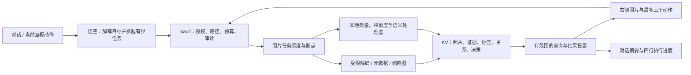

# 悟空的宝箱：把照片变成可以对话的记忆

日期：2026-10-18。状态：首期界面与真实照片索引、用户标签 KV 已接入；附三张视觉概念稿及独立交互预览。图中人物、照片、数量、处理结果都是演示素材。

本文延续 [悟空家庭资料管家](jiaho-wukong-family-steward.md)、[文件索引](file-index.md) 与家合现有视觉。新增三个 Tauri-only 用户命令已同步 `docs/contract.md`，Rust 与 React 接线，sidecar/R1/Webdesk 不注册对应工具或扩展权限。开发验收使用合成临时目录与独立示例素材，没有扫描用户照片。

## 本轮已实现的范围

- 用户确认三张图属于同一宝箱的三种任务场景：回忆、挑选、成长选片。点击宝箱保留悟空对话；最近用户消息产生本机场景建议，由用户选择，不自动改变原件。
- 四行处理摘要可滚动，工具过程不占满聊天；手动查看旧进度时停止自动跟随。右侧固定最多三个主要业务操作，小屏为照片抽屉，聊天仍可继续。
- `photo_library_query` 查询照片、文件名/路径和已保存的用户标签；分页最多 100 条，UI 每页 12 张。用户可以明确说“找照片：海边”或“找‘海边’的照片”。
- `photo_preview` 通过 Vault no-follow 读取已索引照片，复验 SHA、文件变化、普通文件和单链接要求，限制 12 MiB；魔数验证 JPEG/PNG/GIF/WebP/AVIF。SVG、RAW 等未支持格式明确不可预览。前端缩为显示尺寸；独立受限解码进程仍待后续实现。
- `photo_tags_set` 将用户确认的人物/地点/事件/拍摄日期/备注/保留选择存入私有 redb 独立 `photo_tags_v1` 表，绑定相对路径与 SHA。重扫保留标注，内容变化后旧标注不用于新内容；改名后的身份对账尚未实现。
- 聊天中“人物是小满，地点是三亚，事件是第一次看海”等明确描述会填入当前照片标注表，供用户核对保存；不从人脸或助手回复自动认定姓名。
- 挑选支持当前照片标记保留、SHA 相同副本查询，保留各自来源；没有删除或自动腾空间。成长场景支持选片、确认生日后的年龄排序、缺失年龄提示、照片故事播放与 `treasure/stories/<uuid>.json` 草稿保存。预览不是已渲染视频。
- 自动人脸/地点识别、语义聚类、模糊/垃圾判断、可恢复清理和真实视频导出仍属后续阶段。以下相应架构是目标方案，不能作为已发布能力说明。

预览命令 `npm run preview:treasure`，本机端口 1431；示例图在 `scripts/fixtures/treasure-assets/`，不进入生产照片库或主应用包。

## 1. 产品概念

**你说想留下什么，悟空把那段记忆带到眼前。**

宝箱是悟空当前工作的照片空间。打开宝箱，对话仍然在中间，右侧出现与这次谈话相关的照片。用户说“找出来”“这张不要”“这是小满”“做成一段视频”，系统把这些话变成可预览、可修正的照片任务。

用户不必先决定进入人物、地点、相册、标签还是重复照片页面。人物、地点、时间、事件是背后的关联维度，同一张照片可以属于多个故事。文件目录保留为来源，用户需要时能找到原件。

三个体验承诺：

1. 每次只处理当前这一件事；面板最多一个主要动作、两个辅助动作。
2. 显示照片、判断依据和处理结果；长期知识来自有来源、能纠正的记录。
3. 整理先建立视图，清理先给出保留方案，创作先生成草稿。

## 2. 三张视觉概念

以下编号与本次对话中的图片显示顺序一致，均使用内置 Image Gen。用户已确认：以第一张建立主布局，后两张成为同一工作台的任务状态，由聊天意图给出场景建议。

| 图 | 文件 | 探索重点 |
| --- | --- | --- |
| 1 | [记忆工作台](design/wukong-treasure/concept-01-workbench.png) | 找回一次经历；一张主照片与少量相关照片并列，照片和对话同等重要 |
| 2 | [此刻放映室](design/wukong-treasure/concept-02-screening.png) | 挑选连拍；大图比较，其他候选缩成胶片条，一次做一个决定 |
| 3 | [人生长卷](design/wukong-treasure/concept-03-lifestory.png) | 成长影片；按年龄组织选片，展示缺失阶段，先看叙事草稿 |

实施时直接复用 `jiaho-boot-logo.png` 和现有 `WukongHead`，不用生成稿重画品牌。第三张的天气/所在地装饰不属于产品需求，实施时移除。生成稿只是视觉探索，不能将其中“找到”“已选择”当作真实任务回执。[生成提示词](design/wukong-treasure/image-prompts.md) 随稿保留。

## 3. 固定结构，流动内容

桌面基准视口 1440 × 1024：左侧 76–88px 轻量入口，中间约 480–560px 对话，右侧使用剩余空间呈现照片。右侧最小宽度建议 520px，可拖动分界线；具体按真实屏幕验证。

- 左侧只保留家合、悟空、宝箱和底部设置。点击宝箱进入照片上下文，保留悟空会话，不再创建“照片 Agent”。
- 中间显示当前目标、助手答复、四行处理摘要、固定输入框。用户可以继续说话改变选片、范围、人物、事件和影片风格。
- 右侧是与目标同步的工作画布，支持精选照片、比较、事件集合、人物核对和影片选片几种呈现。不同呈现使用同一容器，不另开多个常驻窗口。
- 顶部用一句话命名当前内容，如“第一次看海”。时间、地点、照片数只有在存在相应证据时出现；未确认地点不写成事实。
- 中间和右侧分别滚动；选片、预览位置随任务保留，消息到来不让照片跳回顶部。
- 窄屏保留聊天，照片变成可展开的工作抽屉；抽屉内仍使用同一组操作。字体不靠缩小到难读来适配。

视觉使用家合暖白 `#fbf8f0`、纸白 `#fffdf8`、墨绿 `#23463c`、灰绿 `#77867a`、细线 `#e2e4d9`；照片保持自然全彩。正文 14–16px，元信息不小于 12px。先用留白和排版组织，再用分隔线，不把每段话和每张照片都装进卡片。

## 4. 打开宝箱的第一分钟

**已有授权照片**：查询最近一次索引与用户正在处理的任务。右侧优先恢复未完成的照片选择，或展示少量近期照片；中间说“想找回哪一刻？”不把未经检查的全库统计写成“已经整理好”。

**尚无照片来源**：右侧一个安静空状态“把照片放进来，剩下的交给悟空。”主要动作“添加照片来源”。由用户选择文件/目录或现有受控存储资源；后续授权和导入由核心执行。

**首次理解**：用户说“整理这些照片”后创建有范围的任务。先完成可确定的文件检查，再分批理解。第一批结果可用就展示，不等待所有图片语义分析结束。任务可暂停、恢复；照片尚未理解时照常可浏览。

不自动扫描所有存储层，不把“点击宝箱”当作全库语义分析或上传授权。本地/高速/低速/云端资源复用存储服务的来源引用；用户只选择可见照片来源，物理层细节留在服务内部。

## 5. 每个状态最多三个动作

动作随“正在做什么”变化，固定位置显示。一个主要动作，最多两个辅助动作；没有必要就只显示一个。不用“更多”菜单偷偷装进几十个功能。点照片放大、在候选中选中一张属于直接内容操作，不再给每张照片叠加一排工具。

| 当前目标 | 右侧展示 | 主要动作 | 辅助动作（最多两个） |
| --- | --- | --- | --- |
| 找一次回忆 | 1 张主图 + 4–8 张相关照片 | 做成一段回忆 | 挑选照片、换一组 |
| 完全相同的副本 | 原件候选与副本来源 | 移入待清理 | 全部保留、下一组 |
| 相似/连拍挑选 | 推荐大图 + 候选胶片条 | 按建议保留 | 三张都留、下一组 |
| 低质量/过期候选 | 原图与一句具体原因 | 移入待清理 | 保留这组、下一组 |
| 人物归属核对 | 少量人像或同组照片 | 确认是小满 | 不是同一人、暂不命名 |
| 地点/事件核对 | 代表照片与日期范围 | 确认这个事件 | 修改名称、拆分这组 |
| 成长影片选片 | 年龄长卷、缺失阶段 | 预览影片 | 调整选片、补充照片 |
| 影片草稿预览 | 可播放草稿与章节 | 导出影片 | 继续修改、返回选片 |
| 清理已执行 | 实际回执与处理范围 | 撤销这次清理 | 继续整理 |

语音/文字与按钮调用同一套带版本的命令。例如“这组都留着”与“全部保留”语义相同；一条含糊的“可以”只确认当前仍有效的提案，不沿用过去的删除决定。

## 6. 四行处理摘要

用户要求的 reasoning 区在界面中称为“处理摘要”。展示当前步骤、工具执行状态和简短依据；不索取或展示模型私有推理链，也不把推测伪装成工具日志。

建议每行 24px，高度固定为四行，超过部分在框内滚动。单条摘要最多一行，长文本可打开该任务的结果说明；详细日志留在任务记录。键盘可滚动，文字可复制，支持减少动画。

示例：

```text
已检索你选择的照片来源
按拍摄日期找到这次旅行
已关联你确认的小满标签
选出 12 张候选照片，等待你查看
```

任务执行时自动跟随最新行；用户向上滚动后停止跟随，显示“有新进度”。完成后保留最后四行。无总量的阶段显示阶段名；只有得到真实完成数/总量才显示百分比。每条记录带任务 ID、事件序号和实际状态，失败时最后成功阶段仍可见。

现有 `ChatBlock` 的 `status` 和工具结果可作为接线起点。若需要新增事件字段或相册结果类型，必须先更新三方契约。用户看到的结果由真实工具回执驱动，不能直接渲染模型编造的“已删除”“已导出”。

## 7. 整理能力：确定性先行，语义理解渐进

| 能力 | 处理方式 | 用户得到什么 |
| --- | --- | --- |
| 完全重复 | 在已授权范围内按 SHA-256 找相同内容，核对实例和来源 | 可比较的副本组与保留方案 |
| 相似/连拍 | 感知特征检索候选，再比较画面、分辨率、质量和拍摄序列 | 推荐照片与可修改候选，不自动判成完全重复 |
| 待清理判断 | 模糊/曝光/损坏等质量信号，截图/收据等内容类型，用户用途规则 | 一句具体原因和待核对分组 |
| 时间 | EXIF 拍摄时间与时区，必要时用户补录；文件修改时间只作线索 | 可修正的时间线，标明时间不确定项 |
| 地点 | 已授权 EXIF GPS 或用户命名；视觉地标只作候选 | 城市/地点聚类与来源，默认不显示精确家庭坐标 |
| 人物 | 用户先选择是否开启本地人物聚类，再核对名称与错误归组 | 可改名、拆分、合并的人物关系 |
| 事件 | 时间邻近、地理邻近、图像内容和用户对话共同形成候选 | “第一次看海”等可命名的故事集合 |
| 创作 | 查询已确认关系、选片、编排、预览、渲染 | 可修改、可再次生成的影片和故事草稿 |

“垃圾”“无用”不是图片本身的客观属性。模糊的第一步可能很珍贵；截图可能是唯一凭证。质量信号和用户的用途判断分开保存。默认文案使用“可能不再需要”“建议检查”，用户可以说“孩子的照片即使模糊也保留”。

文件内容相同也不代表来源、拥有者、共享规则或附带元数据相同。保留推荐要考虑原始分辨率、EXIF、编辑关系、收藏、故事引用和用户指定的主来源；不为了空间把一个仍被影片引用的原件直接删掉。

人物聚类不等于姓名识别。未经确认不把陌生脸挂到家庭成员；跨年龄同一人可能断成多个组，通过用户修正逐步连接。首次生日可由用户给出，用于计算年龄；不能从面容或文件名推断生日作为事实。

## 8. 工作流与服务架构



这是目标架构。照片处理器隔离、相册 KV、断点任务和影片渲染目前都需要新增，不借现有 Worker/Engine 批次标签声称已经具备。

存储服务负责资源位置与空间，Vault 负责谁能访问哪些实例，照片服务负责理解与检索，悟空负责沟通和编排。sidecar 不注册直接 `fs/bash` 工具；通过固定 `vault/*` RPC 发起受控操作。UI 不向底层传入任意命令、路径或自报角色。

解码需要尺寸/像素/内存/时间限制，防止异常图片拖垮主进程；元数据、缩略图、特征与模型推理分阶段排队。首期覆盖已验证的 JPEG/PNG；HEIC、RAW、Live Photo、编辑原片关系和视频支持明确按能力报告，不能静默跳过却声称“全库完成”。

增量任务按内容版本复用结果；处理器版本改变时失效相应特征，保留用户确认。失败重试从检查点恢复，取消后不再提交过期面板。重启后展示“可继续”，不偷偷恢复外发或清理操作。

## 9. KV：让照片成为未来应用的基础

复用本机 redb 的技术方向，在 Vault 内管理新 schema 和迁移。现有文件索引只是一份可重建的路径/哈希快照；不能把需要长期保留的用户命名、人物确认和影片草稿塞进刷新时会整体替换的 `files_v1` 表。

下面是待评审的数据设计，表名不是已发布接口：

| 表/索引 | 主键 | 保存内容 |
| --- | --- | --- |
| `photo_asset_v1` | `home_id + asset_id` | 稳定照片实例 ID、受控来源引用、原始/当前路径引用、内容版本、状态 |
| `photo_content_v1` | `home_id + content_sha256` | 文件内容版本、尺寸、格式、元数据/特征版本；不保存原图字节 |
| `photo_annotation_v1` | `asset_id + annotation_id` | 标签值、来源证据、候选/确认状态、生成器版本、撤回/取代关系 |
| `photo_entity_v1` | `home_id + entity_id` | 已命名或待命名的人、地点、事件；人物生日只保存有权限的引用 |
| `photo_relation_v1` | `entity_id + asset_id + relation_id` | 属于人物/事件/地点的关系、证据和确认状态 |
| `photo_feature_v1` | `content_id + feature_kind + model_version` | 相似特征或语义特征的本地引用；敏感人脸特征使用受保护存储引用 |
| `photo_job_v1` | `job_id` | 授权范围版本、阶段、进度、游标、资源预算、失败项与事件序号 |
| `photo_decision_v1` | `decision_id` | 用户保留/清理/更名/归属修正、提案版本、结果和恢复引用 |
| `photo_story_v1` | `story_id + revision` | 查询条件、选片引用、章节、字幕、时长、源版本、渲染任务/输出引用 |
| 二级索引 | 时间/人物/地点/事件/标签 → 实例 ID | 支持取交集、排序与分页的派生映射；可重建 |

`asset_id` 表示一份有来源和权限的照片实例；`content_sha256` 表示内容。相同内容在多个来源中有多个实例，不能仅凭哈希合并权限。当前文件索引尚无跨路径稳定身份，后续需显式实现来源与移动对账，不能声称沿用现有路径主键就可追踪重命名。

一条事件标签可保存为：

```json
{
  "annotation_id": "ann-demo-01",
  "asset_id": "asset-demo-01",
  "content_revision": "sha256:<version>",
  "kind": "event",
  "entity_id": "event-first-seaside",
  "state": "confirmed",
  "evidence": [
    { "kind": "exif_time", "source_ref": "metadata-demo-01" },
    { "kind": "user_confirmation", "decision_id": "decision-demo-01" }
  ],
  "generator_version": "event-grouping-v1",
  "supersedes": null
}
```

标签状态沿用 `candidate / confirmed / rejected / superseded / retracted`。模型产生候选，用户修正产生决策，重新识别不能覆盖已确认结果。置信分只在需要解释候选时显示，不作为真假或清理授权。

KV 管理可靠记录、关系和倒排索引；大规模相似度检索可以使用独立可重建的本地向量索引，通过受控 ID 回表。不要把 KV 全表扫描当成高维向量检索方案，也不把模型输出 JSON 当成数据库修改命令。

派生照片、标签、事件名、地理位置和人脸特征都可能敏感。索引与缩略图跟随来源权限；人物特征需独立授权和撤销。若复用 redb，只能继承其存储能力，不能直接宣称内容已加密。涉及加密/解密的实现需要单独验收。

## 10. 先设计好上下文预算

照片数量增加时，聊天上下文应保持有界。悟空查询索引和小批结果，图片理解任务在后台产出结构化标签；不会每次提问都重读整库。

- 聊天只接收目标、授权范围、查询条件、少量证据和当前选择；原图、base64、整库标签、人脸特征和整段处理历史不进入消息。
- 一次查询建议默认 24 条、最大 100 条，后续翻页；需要看图时只发送用户授权的少量缩略图。
- 一次理解任务建议从 8 张缩略图一批起步，并按实际模型 Token/图像预算继续切分；这是初始配置，须通过真实模型验收后调整。
- 每个 RPC 设置结果字节上限、页大小和明确的截断/游标字段；不能只限制条数而允许一条超大元数据穿透。
- 长任务只保留阶段摘要、已确认决定、结果引用和检查点。`tasks/history.json` 不作为相册默认上下文。
- 面板来自有 schema 的结果投影，不解析自然语言中的“显示这几张照片”来执行任意路径访问。投影带 `job_id / revision / scope / items / actions`，核心校验动作不超过三个且仍有效。

这条边界也用于未来应用：成长影片需要的是人物、日期、照片引用和选片规则，无须把十八年的图片塞进一次模型请求。

## 11. “把孩子 0—18 岁串成影片”完整体验

1. 用户提出目标。悟空查询已确认人物；若“小满”有歧义，右侧只问一次是哪位，不猜名字。
2. 使用用户确认的生日与照片时间建立年龄段。无拍摄日期的照片单独待核对，缺失阶段明确留空；不生成虚假童年照片补齐。
3. 每个阶段选有差异的代表瞬间，避免连拍重复；分辨率、质量与用户收藏作为候选信号。海边、生日、毕业等事件成为章节建议，不凭图片杜撰经历。
4. 先给选片长卷。用户说“每年三张”“不要公开学校”“把这次旅行留长一点”，只修改草稿的新版本。
5. 生成有来源的分镜、字幕和节奏预览。默认使用照片原画面与自然转场；人像变脸、补生长阶段或拟人语音都不是默认步骤。
6. 先产出低成本影片预览，用户确认后导出本机文件；保存故事清单，之后可换照片、改章节、重新渲染。

音乐只使用用户提供或产品已具备使用权的素材，未选择时可静音。若使用照片原声，需要确有对应 Live Photo/视频/音轨且用户选择，不能声称静态照片里存在笑声。

## 12. 清理、恢复与真实结果

“移入待清理”应成为后续新增的可恢复动作：保存原路径、版本、引用和恢复信息；检查备份/云源删除语义、故事依赖与剩余存储空间。移动到待清理不一定释放物理空间，界面按实际回执显示，不能立刻报“已释放”。

完全清除、远端同步删除需要独立明确的选择。首期不自动清除，不给出未经实现支持的“30 天自动恢复”承诺。确认前重新校验源版本和提案版本；照片变化后旧提案失效，用户清理相似照片的一次选择不扩展到整库。

标签纠错、来源撤销和原件消失会使相应搜索结果及草稿失效。刷新索引时移除失效派生引用，保留可解释的历史决策；导出过的影片不会因删除标签自动消失，产品要说明并提供实际可执行的管理方式。

## 13. 实施顺序与验收

**先做一个真实闭环，再增加理解深度。**

| 阶段 | 可交付范围 | 验收重点 |
| --- | --- | --- |
| A：对话照片工作台 | 选定视觉后实现宝箱入口、四行摘要、右侧照片与分页；复用照片/SHA 索引 | 原生真实图片可见；空状态真实；每个状态动作 ≤3；无扫描权限不读图 |
| B：留好与清理 | 完全重复、相似候选、质量信号、保留/待清理及撤销 | 相似不误当完全重复；不同来源保留；失败可恢复；空间变化有真实回执 |
| C：照片关系 | 元数据、用户标签、人物可选聚类、事件与跨条件检索 | 可以命名/纠错/拆分；重扫不覆盖用户决定；权限与来源一致 |
| D：记忆创作 | 年龄/事件选片、故事清单、预览与本机影片导出 | 缺失年龄可见；每帧可追溯原件；草稿修改有效；导出真正可播放 |

阶段 A 也应支持用户手工说“这是小满”“这是第一次看海”并保存已确认标签；不必等到人脸和语义模型完全成熟才提供有用的宝箱。

正式实现至少验证：四行滚动/中英文/窄屏与键盘操作；过期请求不替换当前任务；照片更改后旧清理提案拒绝；损坏/超大图片有界失败；HEIC/RAW 能力缺失真实可见；人物错误可撤回；相同 SHA 不跨来源误合并；源权限收回后无法继续看缩略图/特征；缺失年份不编造；十万级目标库使用分页和增量处理并测量资源预算；中断/重启不重复执行清理或影片渲染。

现有可复用部分：`DepDekAiOsShell` 的三栏、对话、语音输入与审批回执；`file_index` 的分类、SHA、查询与快照；Vault 的授权与审计。需要新增的部分：受控图片解码/缩略图、照片稳定身份、标签与关系 KV、后台处理器、面板投影、清理恢复和影片流水线。视觉稿完成不代表这些能力已经实现。
